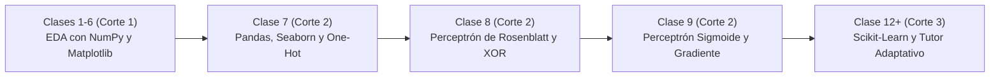

# 📚 IA_TutorIngles - Tutor Inteligente de Lectura y Comprensión en Inglés

**Asignatura:** Inteligencia Artificial (Semestre 6)  
**Institución:** Corporación de Estudios Tecnológicos del Norte del Valle (COTECNOVA) — Cartago, Valle del Cauca  
**Docente:** Jhon James Cano Sánchez  
**Equipo de Trabajo:** Jhon Esteban Molina Echavarría, Heiber Lozano Mercado  
**Repositorio GitHub:** [https://github.com/moliech/IA_TutorIngles](https://github.com/moliech/IA_TutorIngles)  
**Video de Sustentación (Avance 2):** [Google Drive](https://drive.google.com/drive/folders/154DKFAKOyDlauuwDyoacq1mFkrTdBTYA?usp=drive_link)

---

## 📌 Resumen Ejecutivo del Proyecto

`IA_TutorIngles` es una plataforma analítica e inteligente diseñada para evaluar la extensión en palabras, la complejidad léxica y los tiempos estimados de lectura en textos en inglés graduados según el **Marco Común Europeo de Referencia para las Lenguas (CEFR: A1 a C2)**.

El objetivo central es diagnosticar cuantitativamente el nivel de los textos para mitigar la dependencia hacia la traducción literal palabra por palabra en los estudiantes de Cartago, garantizando la asignación adaptativa de lecturas de acuerdo con la capacidad lingüística del usuario y sus intereses temáticos.

---

## 🔗 Accesos Directos a Archivos de Interés

- 📄 **Informe Académico Completo — Segundo Corte (Avance 2):** [Informe_Corte_2.md](Informe_Corte_2.md) | [informes/Informe_Corte_2.md](informes/Informe_Corte_2.md)
- 🎥 **Video de Sustentación — Segundo Corte:** [Google Drive (≤ 5 min)](https://drive.google.com/drive/folders/154DKFAKOyDlauuwDyoacq1mFkrTdBTYA?usp=drive_link)
- 📄 **Informe Académico Completo — Primer Corte:** [Informe_Corte_1.md](Informe_Corte_1.md) | [informes/Informe_Corte_1.md](informes/Informe_Corte_1.md)
- 🧠 **Informe de Reflexión sobre Neuronas Artificiales (Clase 8):** [informes/reflexion_aprendizaje_neurona.md](informes/reflexion_aprendizaje_neurona.md)
- 📊 **Informe Dinámico Exportado por Código:** [informes/informe_proyecto.md](informes/informe_proyecto.md)
- 📁 **Dataset Base Estandarizado (40 Lecturas):** [data/lecturas_ingles.csv](data/lecturas_ingles.csv)
- 🧹 **Dataset Limpio Exportado con Pandas (Clase 7):** [data/proyecto_limpio.csv](data/proyecto_limpio.csv)
- 🤖 **Dataset Codificado para Machine Learning (`get_dummies`):** [data/lecturas_preparadas_ml.csv](data/lecturas_preparadas_ml.csv)
- 🎯 **Perceptrón con Descenso del Gradiente en NumPy (Clase 9):** [src/perceptron_proyecto.py](src/perceptron_proyecto.py)
- 🚀 **Orquestador Principal en Python:** [src/main.py](src/main.py)
- 🖼️ **Directorio de Visualizaciones Exportadas:** [graficos/](graficos/)

---

## 📚 Índice General de Clases y Avances del Proyecto

A continuación se detalla la progresión pedagógica y técnica del proyecto clase por clase:



### 1. Primer Corte (Clases 1 a 6) — Análisis Exploratorio y Métricas Base
- **Objetivo:** Comprender cuantitativamente el corpus de lecturas en inglés graduadas por nivel CEFR (A1 a B2).
- **Módulos desarrollados:**
  - Ingesta de CSV y estructuración tabular: [`src/cargar_datos.py`](src/cargar_datos.py)
  - Cálculo de estadísticas descriptivas con NumPy ($\mu, \sigma, Q_2, \min, \max$): [`src/eda_numpy.py`](src/eda_numpy.py)
  - Generación de gráficos descriptivos con Matplotlib: [`src/visualizaciones.py`](src/visualizaciones.py)
  - Generación de informe técnico dinámico en Markdown: [`src/generar_informe.py`](src/generar_informe.py)
- **Entregable del corte:** 👉 [Informe_Corte_1.md](Informe_Corte_1.md)

### 2. Segundo Corte — Clase 7: Preparación de Datos con Pandas y Seaborn
- **Objetivo:** Auditar calidad de datos sobre lote crudo, corregir anomalías, realizar ingeniería de variables y visualizaciones estadísticas avanzadas.
- **Implementación:** [`src/preparacion_datos_pandas.py`](src/preparacion_datos_pandas.py)
- **Logros clave:**
  - Inspección inicial con `shape`, `info()`, `isnull().sum()` y `duplicated().sum()`.
  - Tratamiento justificado de categorías inconsistentes (12 variantes $\to$ 6 canónicas), 3 filas duplicadas, 3 valores imposibles y 2 valores nulos imputados por la mediana agrupada por `nivel_cefr` y `categoria`.
  - Variable derivada `velocidad_lectura_ppm` (palabras por minuto estimadas).
  - Transformación *One-Hot Encoding* con `pd.get_dummies()` expandiendo a 14 columnas tabulares.
  - Exportación de [`data/proyecto_limpio.csv`](data/proyecto_limpio.csv) y [`data/lecturas_preparadas_ml.csv`](data/lecturas_preparadas_ml.csv).
  - 3 gráficos con Seaborn: [`graficos/seaborn_distribucion_ppm.png`](graficos/seaborn_distribucion_ppm.png), [`graficos/seaborn_palabras_por_cefr.png`](graficos/seaborn_palabras_por_cefr.png) y [`graficos/seaborn_dificultad_vs_tiempo.png`](graficos/seaborn_dificultad_vs_tiempo.png).

### 3. Segundo Corte — Clase 8: Redes Neuronales Artificiales y Perceptrón Simple
- **Objetivo:** Explorar los fundamentos de las neuronas artificiales de Rosenblatt y sus límites de separabilidad lineal.
- **Módulos desarrollados:**
  - Laboratorio de compuertas lógicas (AND, OR, NOT, NAND y fallo en XOR): [`src/neuronas_compuertas.py`](src/neuronas_compuertas.py)
  - Clasificador neuronal del tutor con función escalón sobre lecturas normalizadas Min-Max: [`src/clasificador_neurona_tutor.py`](src/clasificador_neurona_tutor.py)
- **Documento de reflexión teórica:** 👉 [informes/reflexion_aprendizaje_neurona.md](informes/reflexion_aprendizaje_neurona.md)

### 4. Segundo Corte — Clase 9: Perceptrón desde Cero con Descenso del Gradiente
- **Objetivo:** Construir desde cero un clasificador neuronal probabilístico con función sigmoide, pérdida de entropía cruzada binaria y descenso del gradiente utilizando exclusivamente NumPy.
- **Implementación:** [`src/perceptron_proyecto.py`](src/perceptron_proyecto.py)
- **Logros clave:**
  - Formulación binaria supervisada: Nivel Básico (`0`: A1/A2) vs. Nivel Intermedio-Avanzado (`1`: B1/B2).
  - Exclusión fundamentada de `nivel_cefr` de las entradas para prevenir fuga de datos (*data leakage*).
  - Estandarización de entradas con Z-score ($\mu_1=278.40, \sigma_1=138.56$; $\mu_2=3.21, \sigma_2=1.17$).
  - Entrenamiento durante 500 épocas ($\eta = 0.1$): reducción de pérdida de $0.6931 \to 0.0731$ y exactitud del **$100.00\%$ ($40/40$)**.
  - Gráficos de convergencia: [`graficos/curva_aprendizaje.png`](graficos/curva_aprendizaje.png) y [`graficos/frontera_decision.png`](graficos/frontera_decision.png).
- **Entregable oficial del corte:** 👉 [Informe_Corte_2.md](Informe_Corte_2.md) | [PDF Oficial](https://github.com/moliech/IA_TutorIngles)

### 5. Tercer Corte (Clase 12 en adelante — Próximamente)
- Comparación de modelos supervisados en `Scikit-Learn`: Regresión Logística, Árbol de Decisión y Random Forest con métricas de F1-Score ponderado y matriz de confusión.
- Evaluación sobre partición de prueba (*train/test split*) ante lecturas nuevas no vistas.
- Integración del modelo clasificador con el motor de recomendación adaptativo y prototipo interactivo para estudiantes de Cartago.

---

## 📁 Estructura del Repositorio

```text
IA_TutorIngles/
├── Dockerfile                        # Empaquetado oficial en Python 3.12-slim
├── docker-compose.yml                # Configuración del servicio contenedorizado
├── requirements.txt                  # Dependencias del proyecto (numpy, pandas, matplotlib, seaborn, etc.)
├── README.md                         # Documentación ejecutiva e índice general de clases
├── Informe_Corte_1.md                # Informe académico completo de primer corte
├── Informe_Corte_2.md                # Informe académico completo de segundo corte (Avance 2)
├── data/
│   ├── lecturas_ingles.csv           # Dataset base estandarizado (40 lecturas)
│   ├── proyecto_limpio.csv           # Dataset auditado y limpio exportado con Pandas (Clase 7)
│   └── lecturas_preparadas_ml.csv    # Dataset codificado con One-Hot Encoding listo para ML
├── src/                              # Arquitectura Modular en Python
│   ├── cargar_datos.py               # Módulo 1: Ingesta de CSV y conversión a matrices (Corte 1)
│   ├── eda_numpy.py                  # Módulo 2: Estadísticas descriptivas vectorizadas (Corte 1)
│   ├── visualizaciones.py            # Módulo 3: Generación de gráficos en Matplotlib (Corte 1)
│   ├── preparacion_datos_pandas.py   # Módulo 4: Limpieza Pandas, Seaborn y One-Hot Encoding (Clase 7)
│   ├── generar_informe.py            # Módulo 5: Exportación del informe dinámico en Markdown (Corte 1)
│   ├── neuronas_compuertas.py        # Módulo 6: Perceptrón de Rosenblatt y fallo en XOR (Clase 8)
│   ├── clasificador_neurona_tutor.py # Módulo 7: Clasificador Neuronal con Función Escalón (Clase 8)
│   ├── perceptron_proyecto.py        # Módulo 8: Perceptrón con Sigmoide y Descenso del Gradiente (Clase 9)
│   └── main.py                       # Orquestador central del sistema
├── graficos/                         # Visualizaciones exportadas en 300 DPI (.png)
│   ├── distribucion_cefr_palabras.png
│   ├── relacion_dificultad_extension.png
│   ├── distribucion_tiempos_categoria.png
│   ├── seaborn_distribucion_ppm.png
│   ├── seaborn_palabras_por_cefr.png
│   ├── seaborn_dificultad_vs_tiempo.png
│   ├── fronteras_compuertas.png
│   ├── frontera_lecturas_tutor.png
│   ├── curva_aprendizaje.png
│   └── frontera_decision.png
└── informes/                         # Carpeta de informes generados
    ├── Informe_Corte_1.md
    ├── Informe_Corte_2.md
    ├── informe_proyecto.md
    └── reflexion_aprendizaje_neurona.md
```

---

## 📊 Métricas del Análisis Exploratorio (EDA con NumPy)

| Variable Numérica | Media ($\mu$) | Mediana ($Q_2$) | Desviación Estándar ($\sigma$) | Mínimo | Máximo |
| :--- | :---: | :---: | :---: | :---: | :---: |
| **Conteo de Palabras** | 278.4 palabras | 240.0 palabras | 134.1 palabras | 85.0 palabras | 520.0 palabras |
| **Dificultad Léxica (1.0 - 5.0)** | 3.21 / 5.0 | 3.10 / 5.0 | 1.12 / 5.0 | 1.20 / 5.0 | 5.00 / 5.0 |
| **Tiempo de Lectura Estimado** | 3.10 min | 2.80 min | 1.50 min | 0.90 min | 6.10 min |

---

## 🛠️ Resumen de Limpieza con Pandas (Clase 7)

A través de [`src/preparacion_datos_pandas.py`](src/preparacion_datos_pandas.py) se ejecutó la auditoría de calidad de datos, transformando el lote crudo hacia [`data/proyecto_limpio.csv`](data/proyecto_limpio.csv):

| Métrica de Calidad | Antes de la Limpieza (Crudo) | Después de la Limpieza (`proyecto_limpio.csv`) | Tratamiento Aplicado |
| :--- | :---: | :---: | :--- |
| **Número de filas** | 46 registros | **40 lecturas validadas** | Eliminación de 3 duplicados y 3 registros inválidos |
| **Número de columnas** | 7 columnas | **8 columnas** (14 con `get_dummies`) | Adición de variable derivada `velocidad_lectura_ppm` |
| **Valores nulos totales** | 2 valores nulos (`NaN`) | **0 valores nulos** | Imputación con mediana por `nivel_cefr` y `categoria` |
| **Filas duplicadas** | 3 duplicados | **0 duplicados** | Depuración con `drop_duplicates(keep="first")` |
| **Valores atípicos / imposibles** | 3 registros corruptos | **0 registros corruptos** | Filtrado por reglas de dominio (`palabras>0`, `1<=dif<=5`, `tiempo>0`) |
| **Categorías temáticas** | 12 etiquetas inconsistentes | **6 categorías estandarizadas** | Normalización de cadenas y diccionario de corrección |

---

## 🎯 Resultados del Perceptrón con Descenso del Gradiente (Clase 9)

A través de [`src/perceptron_proyecto.py`](src/perceptron_proyecto.py) se entrenó el clasificador neuronal probabilístico desde cero en NumPy:

| Parámetro / Métrica | Valor Obtenido | Interpretación Técnica |
| :--- | :---: | :--- |
| **Tasa de aprendizaje ($\eta$) y Épocas** | $\eta = 0.10$ · $500$ épocas | Parámetros del descenso del gradiente |
| **Peso $w_1$ (`conteo_palabras`)** | $+2.6936$ | Positivo: mayor extensión incrementa la probabilidad de nivel avanzado |
| **Peso $w_2$ (`dificultad_lexica`)** | $+2.5407$ | Positivo: mayor dificultad léxica incrementa la probabilidad de nivel avanzado |
| **Sesgo ($b$)** | $+0.1333$ | Término independiente de la frontera de decisión lineal |
| **Pérdida inicial $\to$ final** | $0.6931 \longrightarrow 0.0731$ | Reducción de error del $89.45\%$ en entropía cruzada binaria |
| **Exactitud Final (Accuracy)** | **$100.00\%$ ($40/40$)** | Clasificación correcta de las 40 lecturas (separabilidad lineal) |

---

## 🖼️ Galería de Visualizaciones Exportadas

El sistema genera automáticamente 10 gráficos analíticos de alta resolución en la carpeta `graficos/`:

### 1. Conteo Promedio de Palabras por Nivel CEFR (Matplotlib)


*Archivo exportado:* [`graficos/distribucion_cefr_palabras.png`](./graficos/distribucion_cefr_palabras.png?raw=true)

---

### 2. Extensión del Texto vs Dificultad Léxica (Matplotlib)


*Archivo exportado:* [`graficos/relacion_dificultad_extension.png`](./graficos/relacion_dificultad_extension.png?raw=true)

---

### 3. Tiempos Estimados de Lectura por Categoría (Matplotlib)


*Archivo exportado:* [`graficos/distribucion_tiempos_categoria.png`](./graficos/distribucion_tiempos_categoria.png?raw=true)

---

### 4. Distribución de Velocidad de Lectura PPM (Seaborn)


*Archivo exportado:* [`graficos/seaborn_distribucion_ppm.png`](./graficos/seaborn_distribucion_ppm.png?raw=true)

---

### 5. Extensión de Palabras por Nivel CEFR (Seaborn Boxplot)


*Archivo exportado:* [`graficos/seaborn_palabras_por_cefr.png`](./graficos/seaborn_palabras_por_cefr.png?raw=true)

---

### 6. Dificultad Léxica vs Tiempo Estimado de Lectura (Seaborn Scatterplot)


*Archivo exportado:* [`graficos/seaborn_dificultad_vs_tiempo.png`](./graficos/seaborn_dificultad_vs_tiempo.png?raw=true)

---

### 7. Fronteras de Decisión en Compuertas Lógicas y Fallo en XOR (Perceptrón)


*Archivo exportado:* [`graficos/fronteras_compuertas.png`](./graficos/fronteras_compuertas.png?raw=true)

---

### 8. Clasificación Adaptativa de Lecturas con Perceptrón Simple


*Archivo exportado:* [`graficos/frontera_lecturas_tutor.png`](./graficos/frontera_lecturas_tutor.png?raw=true)

---

### 9. Curva de Aprendizaje (Pérdida Logarítmica y Exactitud por Época)


*Archivo exportado:* [`graficos/curva_aprendizaje.png`](./graficos/curva_aprendizaje.png?raw=true)

---

### 10. Frontera de Decisión del Perceptrón (Sigmoide + Descenso del Gradiente)


*Archivo exportado:* [`graficos/frontera_decision.png`](./graficos/frontera_decision.png?raw=true)

---

## 🛠️ Instrucciones para Clonar y Ejecutar el Proyecto

### 1. Clonación del Repositorio
```bash
git clone https://github.com/moliech/IA_TutorIngles.git
cd IA_TutorIngles
```

### 2. Opción A: Ejecución Contenerizada con Docker (Recomendada)
```bash
# Construir y levantar el contenedor en segundo plano:
docker compose up -d --build

# Ingresar a la terminal interactiva del contenedor:
docker exec -it ia-tutor-ingles bash

# Ubicarse en /app/src y ejecutar el perceptrón del proyecto (Clase 9):
cd /app/src
python perceptron_proyecto.py

# Ejecutar el flujo de preparación de datos con Pandas (Clase 7):
python preparacion_datos_pandas.py

# Ejecutar el laboratorio de neuronas y compuertas lógicas (Clase 8):
python neuronas_compuertas.py

# Ejecutar el orquestador general completo:
python main.py
```

### 3. Opción B: Ejecución Directa con Python 3
```bash
# Instalar las librerías necesarias:
pip install -r requirements.txt

# Ejecutar el perceptrón del proyecto:
python3 src/perceptron_proyecto.py

# Ejecutar el programa principal:
python3 src/main.py
```
