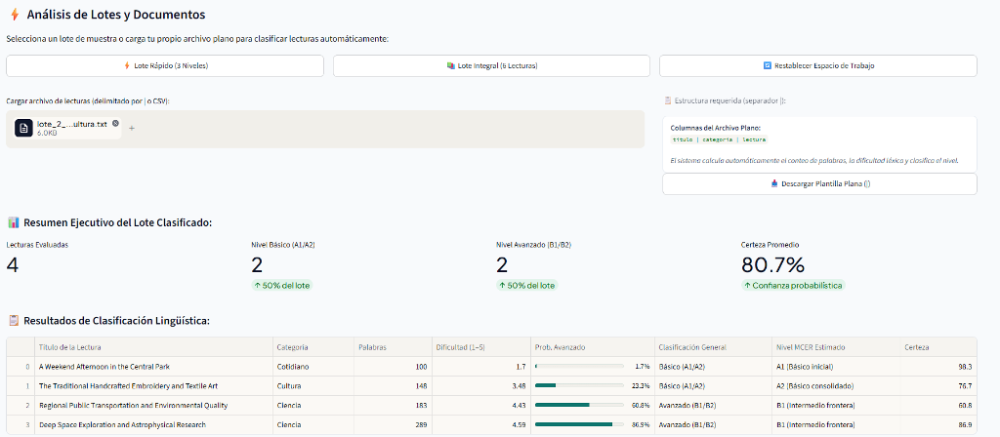
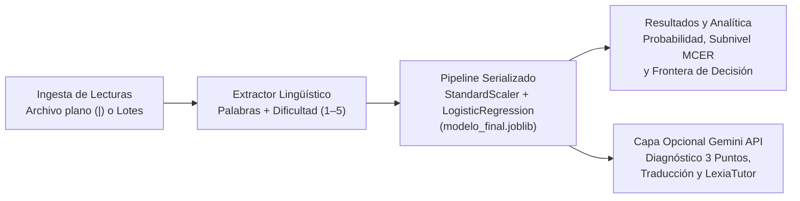
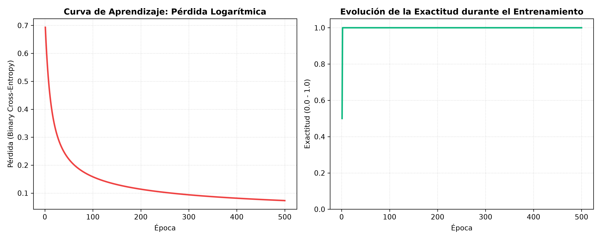
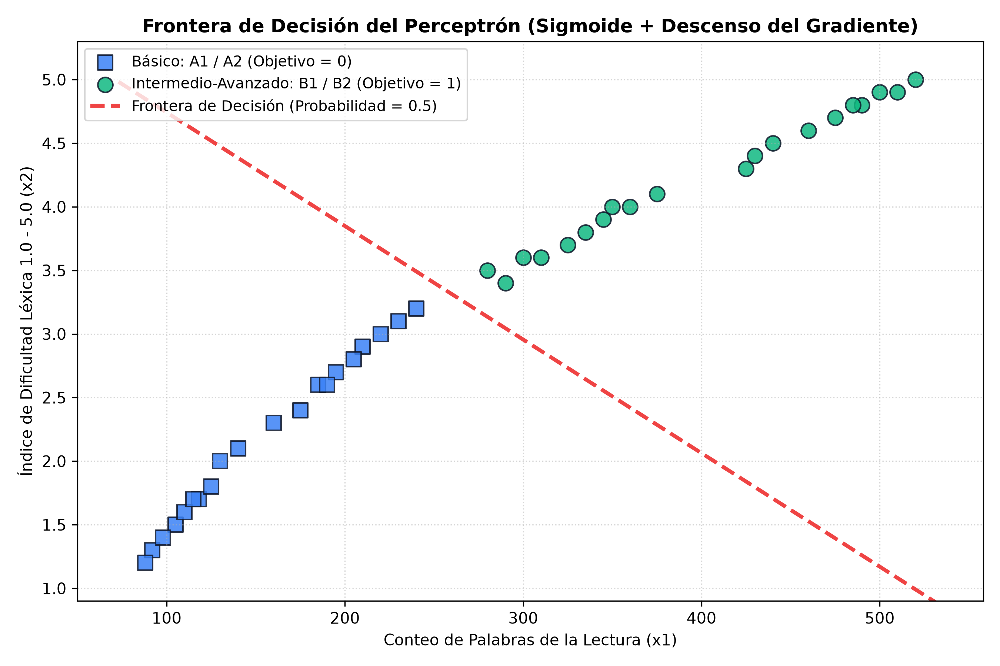
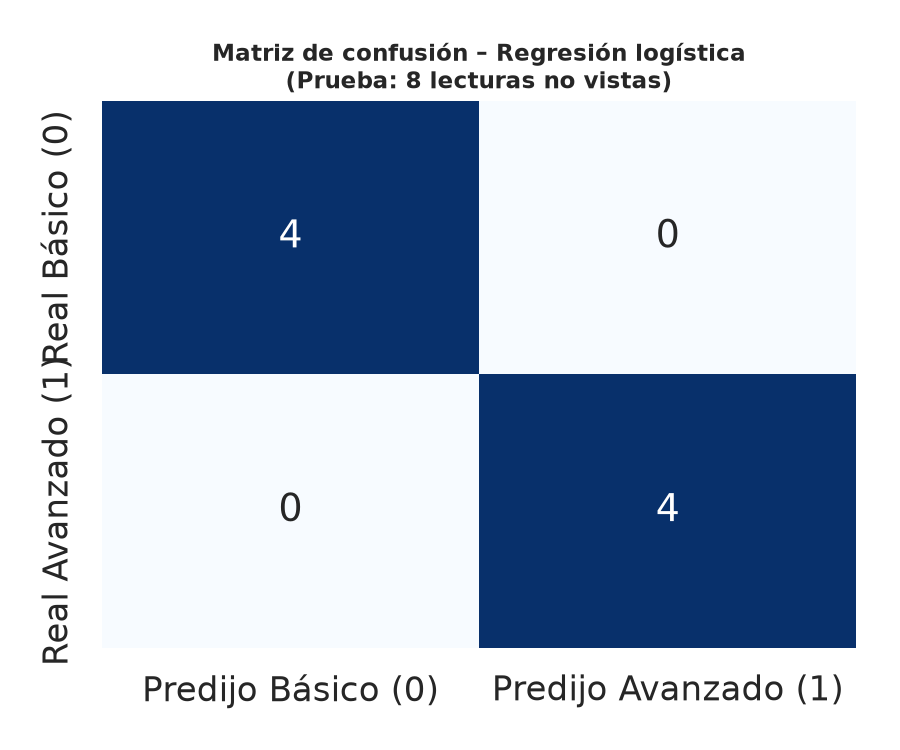
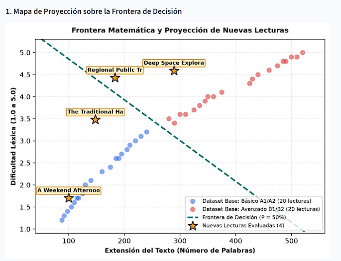
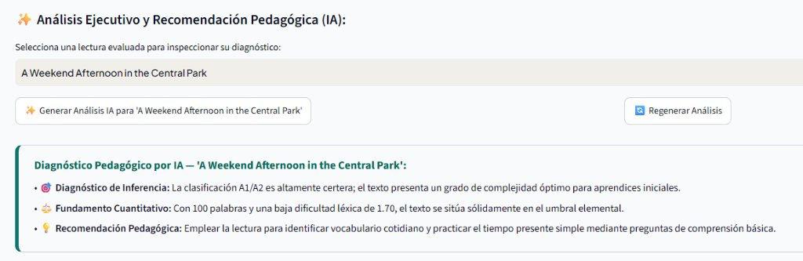
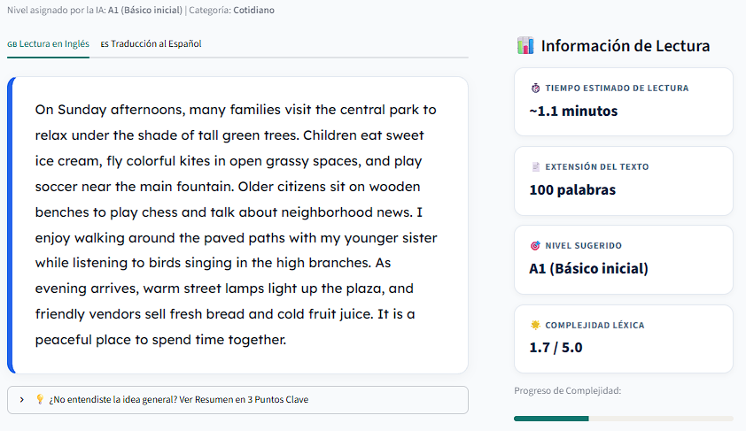

# LexiaAdapt — Plataforma Inteligente de Clasificación Lingüística y Tutoría de Lectura en Inglés


> **Sistema reproducible de Machine Learning e IA Generativa** que clasifica automáticamente textos en inglés según su nivel de complejidad (**Básico A1/A2** frente a **Avanzado B1/B2** del Marco Común Europeo de Referencia — MCER), proyecta lecturas inéditas sobre su frontera matemática de decisión y brinda acompañamiento pedagógico bilingüe.

<p align="center">
  
</p>

---

## Tabla de Contenidos

1. [Resumen y Alcance del MVP](#-resumen-y-alcance-del-mvp)
2. [Arquitectura del Sistema](#-arquitectura-del-sistema)
3. [Prerrequisitos](#-prerrequisitos)
4. [Instalación y Montaje Paso a Paso (Docker)](#-instalación-y-montaje-paso-a-paso-docker)
5. [Configuración Opcional de Google Gemini (IA Generativa)](#-configuración-opcional-de-google-gemini-ia-generativa)
6. [Ejecución de Scripts por Consola (Sin Reentrenar y Pipeline Completo)](#-ejecución-de-scripts-por-consola-sin-reentrenar-y-pipeline-completo)
7. [Formato de Archivo Plano para Evaluar Lecturas Propias](#-formato-de-archivo-plano-para-evaluar-lecturas-propias)
8. [Resultados del Modelo y Evidencias Visuales](#-resultados-del-modelo-y-evidencias-visuales)
9. [Estructura del Repositorio](#-estructura-del-repositorio)
10. [Documentación e Informes](#-documentación-e-informes)
11. [Solución de Problemas Frecuentes](#-solución-de-problemas-frecuentes)
12. [Equipo e Institución](#-equipo-e-institución)

---

## 📌 Resumen y Alcance del MVP

En el contexto educativo de **Cartago, Valle del Cauca** (donde las pruebas Saber 11 registran un promedio en inglés de 55,5/100 y una brecha de 27,9 puntos entre colegios oficiales y privados), las lecturas en inglés suelen asignarse de forma uniforme sin medir el nivel real del estudiante. **LexiaAdapt** ataca este problema automatizando la evaluación cuantitativa de textos y ofreciendo apoyo de comprensión lectora.

### ¿Qué incluye esta versión funcional?
* **Pipeline de datos reproducible (`Pandas` + `Seaborn`):** Depuración documentada desde 46 registros crudos hasta un corpus balanceado de **40 lecturas limpias** (20 Básicas A1/A2 y 20 Avanzadas B1/B2), sin fuga de información.
* **Perceptrón probabilístico desde cero (`NumPy`):** Implementación matemática propia con estandarización Z-score, función sigmoide, entropía cruzada binaria y descenso del gradiente en 500 épocas.
* **Comparativa en `Scikit-Learn`:** Evaluación de 4 clasificadores encapsulados en `Pipeline` (`StandardScaler` + modelo) con partición estratificada 80/20 y validación cruzada de 5 pliegues; exportación del mejor modelo en `src/modelo_final.joblib`.
* **Inferencia en vivo sin reentrenar (`src/usar_modelo.py` + `Streamlit`):** Carga de lotes preconfigurados o archivos planos (`titulo|categoria|lectura`), cálculo automático de palabras y dificultad léxica, asignación binaria oficial, estimación orientativa de subnivel MCER (`A1–B2`), proyección de **estrellas doradas** sobre la frontera de decisión y exportación a CSV.
* **Capa opcional de IA Generativa (`Google Gemini`):** Diagnóstico ejecutivo en tres puntos, traducción contextual al español, resumen en 3 puntos clave y tutor académico formal (`LexiaTutor`).
* **Biblioteca curada base:** Espacio de lectura guiada con ajuste de tamaño tipográfico y pestañas bilingües sobre las 40 lecturas graduadas.

### Alcance y Limitaciones Conocidas
* El clasificador supervisado predice formalmente **dos clases** (`Básico A1/A2` vs. `Avanzado B1/B2`); el subnivel (`A1`, `A2`, `B1`, `B2`) es una heurística orientativa basada en la probabilidad sigmoidal.
* El corpus de entrenamiento contiene 40 lecturas balanceadas (`n = 8` en prueba); en textos inéditos breves pero muy técnicos (por ejemplo, 127 palabras con dificultad 4.19), el peso de la extensión puede sesgar la predicción lineal, motivo por el cual la capa de Gemini sirve como auditoría complementaria.
* **Funcionamiento garantizado sin clave de API:** Si no se configura `.env`, toda la inferencia de Machine Learning, las gráficas y la biblioteca funcionan normalmente; únicamente queda inactivo el módulo generativo de Gemini.

---

## 🏗️ Arquitectura del Sistema



---

## ✅ Prerrequisitos

Antes de instalar, verifique que su equipo cuenta con **Git** y **Docker** instalados y activos. Abra una terminal (PowerShell en Windows, Terminal en macOS o Bash en Linux) y ejecute:

```bash
git --version
docker --version
docker compose version
```

**Requisitos mínimos esperados:**
* **Git** `2.x` o superior.
* **Docker Desktop** (Windows/macOS) o **Docker Engine + Compose v2** (Linux) **encendido y en ejecución**.
* **Puerto `8501` disponible** en `localhost`.
* Conexión a internet durante la primera construcción de la imagen Docker para descargar Python 3.12 y las dependencias de `requirements.txt`.

> **Nota:** No es necesario instalar Python, entornos virtuales ni librerías manualmente en su sistema operativo; todo se construye y ejecuta de forma aislada dentro del contenedor Docker.

---

## 🚀 Instalación y Montaje Paso a Paso (Docker)

Siga estos **3 pasos exactos** desde una carpeta vacía para levantar la plataforma desde cero:

### Paso 1. Clonar el repositorio e ingresar a la carpeta

```bash
git clone https://github.com/moliech/IA_TutorIngles.git
cd IA_TutorIngles
```

### Paso 2. Construir la imagen y encender el contenedor

```bash
docker compose up -d --build
```

> ⏱️ *La primera vez tardará entre 1 y 2 minutos mientras descarga `python:3.12-slim` e instala `numpy`, `pandas`, `scikit-learn`, `matplotlib`, `seaborn`, `joblib` y `streamlit`.*

Verifique que el contenedor `ia-tutor-ingles` esté activo (`Up`):

```bash
docker ps
```

### Paso 3. Abrir la aplicación en el navegador

Abra su navegador web y visite:

```text
http://localhost:8501
```

**Prueba rápida de 15 segundos para verificar que todo funciona:**
1. En la pantalla principal (**Clasificador Predictivo e Inferencia IA**), pulse **`⚡ Lote Rápido (3 Niveles)`** (o arrastre cualquier archivo `.txt` desde `data/ejemplos_demostracion/`).
2. Pulse el botón primario **`🚀 Ejecutar Clasificación con IA`**.
3. Verifique la tabla con palabras calculadas, dificultad, probabilidad y nivel estimado.
4. Abra la pestaña **`📊 Analítica del Modelo y Frontera de Decisión`** para ver las nuevas lecturas proyectadas como **estrellas doradas** sobre la frontera de decisión.

### Detener la aplicación al finalizar

```bash
docker compose down
```

---

## 🔑 Configuración Opcional de Google Gemini (IA Generativa)

> **Importante:** Por políticas de seguridad y buenas prácticas, ninguna clave de API se almacena en GitHub. **El clasificador ML y la interfaz funcionan completamente sin este paso.**

Si desea habilitar el diagnóstico en lenguaje natural, la traducción automática y el chat con `LexiaTutor`:

1. Obtenga una clave gratuita en **Google AI Studio**: [https://aistudio.google.com/apikey](https://aistudio.google.com/apikey) *(inicie sesión con cuenta Google → **Create API key**)*.
2. En la raíz del proyecto, cree el archivo `.env` a partir de la plantilla incluida:
   * **Linux / macOS / Git Bash:**
     ```bash
     cp .env.example .env
     ```
   * **Windows PowerShell:**
     ```powershell
     Copy-Item .env.example .env
     ```
3. Abra el archivo `.env` con cualquier editor de texto y pegue su clave:
   ```env
   GEMINI_API_KEY=AIzaSy...tu_clave_aqui...
   ```
4. Reinicie el contenedor para cargar la variable de entorno:
   ```bash
   docker compose up -d --force-recreate
   ```
5. Recargue `http://localhost:8501` y pulse **`✨ Generar Análisis IA`** sobre cualquier lectura evaluada.

---

## 💻 Ejecución de Scripts por Consola (Sin Reentrenar y Pipeline Completo)

Con el contenedor `ia-tutor-ingles` encendido, es posible ejecutar directamente cada módulo Python desde la terminal:

| Objetivo | Comando exacto |
| :--- | :--- |
| **Inferencia en vivo sin reentrenar** (`modelo_final.joblib`) | `docker exec ia-tutor-ingles python src/usar_modelo.py` |
| **Preparación y limpieza de datos** (`46 → 40` + gráficos Seaborn) | `docker exec ia-tutor-ingles python src/preparacion_datos_pandas.py` |
| **Perceptrón desde cero en NumPy** (500 épocas + curva + frontera) | `docker exec ia-tutor-ingles python src/perceptron_proyecto.py` |
| **Comparación de 4 modelos Scikit-Learn** (+ matriz + `.joblib`) | `docker exec ia-tutor-ingles python src/modelo_proyecto.py` |
| **Orquestador completo del pipeline** | `docker exec ia-tutor-ingles python src/main.py` |

---

## 📄 Formato de Archivo Plano para Evaluar Lecturas Propias

La plataforma soporta archivos `.txt` o `.csv` delimitados por barra vertical (`|`) para evitar conflictos con las comas naturales del inglés. El usuario solo suministra `titulo`, `categoria` y `lectura`; el sistema calcula automáticamente las palabras y la dificultad léxica:

```text
titulo|categoria|lectura
My Daily Morning Routine|Cotidiano|I wake up early every day at six in the morning. First, I wash my face and brush my teeth. Then, I prepare breakfast and walk to the university campus with my friends.
Sustainable Renewable Energy|Ciencia|The structural transition toward decentralized solar energy and biomass generation represents a strategic milestone for sustainable agricultural production across Latin America.
```

En la carpeta [`data/ejemplos_demostracion/`](data/ejemplos_demostracion/) hay **3 lotes listos para cargar y probar**:
* `lote_1_variado_niveles.txt` (4 lecturas cubriendo A1, A2, B1 y B2).
* `lote_2_educacion_y_cultura.txt` (4 lecturas de cultura, sociedad y astrofísica).
* `lote_3_casos_frontera.txt` (incluye casos frontera y el caso crítico breve *Quantum Computing*).

---

## 📊 Resultados del Modelo y Evidencias Visuales

### 1. Comparación de Modelos en Scikit-Learn (Partición 80/20 Estratificada: 32 Train / 8 Test)

| Modelo (en `Pipeline` con `StandardScaler`) | Exactitud (Test) | Precisión (Test) | Recall (Test) | F1-Score (Test) | Val. Cruzada (5-fold) |
| :--- | :---: | :---: | :---: | :---: | :---: |
| **★ Regresión Logística (Seleccionado)** | **1.00** | **1.00** | **1.00** | **1.00** | **1.00** |
| KNN (5 vecinos) | 1.00 | 1.00 | 1.00 | 1.00 | 1.00 |
| Árbol de Decisión (`max_depth=3`) | 1.00 | 1.00 | 1.00 | 1.00 | 1.00 |
| Red Neuronal (`MLPClassifier`) | 1.00 | 1.00 | 1.00 | 1.00 | 1.00 |

### 2. Pesos Aprendidos e Interpretación
* **Perceptrón desde cero en NumPy** (`n = 40`, 500 épocas, $\eta = 0.1$): pérdida `0.6931 → 0.0731`, exactitud `100.00 %` en entrenamiento, pesos $w_1 = +2.6936$ (palabras), $w_2 = +2.5407$ (dificultad), $b = +0.1333$.
* **Regresión Logística en Scikit-Learn** (`n_train = 32`, `n_test = 8`): elegida por parsimonia e interpretabilidad, pesos $w_1 = +1.64$ (palabras), $w_2 = +1.50$ (dificultad), $b = +0.08$, matriz de confusión `[[4, 0], [0, 4]]`.
* **Interpretación:** En ambos modelos los dos pesos son positivos y equilibrados; a mayor extensión textual y mayor dificultad léxica, mayor es la probabilidad de pertenecer al nivel Avanzado (B1/B2).

### 3. Gráficos de Entrenamiento, Evaluación e Interfaz Web

| Curva de Aprendizaje (Perceptrón NumPy) | Frontera de Decisión Lineal |
| :---: | :---: |
|  |  |

| Matriz de Confusión (Test `n = 8`) | Proyección de Lecturas Nuevas en Vivo |
| :---: | :---: |
|  |  |

| Diagnóstico Pedagógico con Google Gemini | Lector Interactivo Bilingüe y Métricas |
| :---: | :---: |
|  |  |

---

## 📁 Estructura del Repositorio

```text
IA_TutorIngles/
├── Dockerfile                        # Imagen reproducible Python 3.12-slim
├── docker-compose.yml                # Servicio web Streamlit (puerto 8501) + env_file opcional
├── requirements.txt                  # Dependencias fijadas del proyecto
├── .env.example                      # Plantilla segura para clave opcional de Gemini
├── .gitignore                        # Excluye .env, __pycache__ y archivos temporales
├── README.md                         # Documentación técnica y guía de montaje
├── data/
│   ├── lecturas_ingles.csv           # Corpus base estandarizado
│   ├── proyecto_limpio.csv           # 40 lecturas depuradas con Pandas
│   ├── lecturas_preparadas_ml.csv    # Dataset con codificación One-Hot (14 columnas)
│   ├── traducciones_espanol.json     # Caché local de traducciones del catálogo base
│   └── ejemplos_demostracion/        # 3 archivos planos (|) listos para pruebas en vivo
├── docs/
│   ├── Informe_Final_IATutorIngles.pdf # Informe final oficial (Normas APA 7)
│   ├── Informe_Final_IATutorIngles.md  # Fuente estructurada en Markdown
│   └── capturas/                       # Evidencias visuales de ejecución en Docker
├── graficos/                         # 12 gráficos PNG (Seaborn, Matplotlib y evaluación ML)
├── informes/                         # Informes históricos de avances previos
└── src/
    ├── app.py                        # Interfaz web comercial en Streamlit (LexiaAdapt)
    ├── usar_modelo.py                # Inferencia en vivo sin reentrenar y proyección
    ├── modelo_proyecto.py            # Comparativa Scikit-Learn y exportación .joblib
    ├── modelo_final.joblib           # Pipeline serializado (StandardScaler + LogisticRegression)
    ├── perceptron_proyecto.py        # Perceptrón sigmoide desde cero con NumPy
    ├── preparacion_datos_pandas.py   # Limpieza de datos, imputación y gráficos Seaborn
    ├── gemini_tutor.py               # Cliente REST para Google Gemini (explicabilidad y tutor)
    ├── ui_theme.py                   # Tokens visuales y tipografía accesible WCAG
    └── main.py                       # Orquestador secuencial por consola
```

---

## 📚 Documentación e Informes

* **Informe Final del Proyecto (PDF Oficial — Normas APA 7):** [`docs/Informe_Final_IATutorIngles.pdf`](docs/Informe_Final_IATutorIngles.pdf)
* **Informe Final (Versión Markdown):** [`docs/Informe_Final_IATutorIngles.md`](docs/Informe_Final_IATutorIngles.md)
* **Informe de Análisis Exploratorio (EDA):** [`informe_proyecto.md`](informe_proyecto.md)
* **Informes de Avances Previos:** [`Informe_Corte_1.md`](Informe_Corte_1.md) · [`Informe_Corte_2.md`](Informe_Corte_2.md)

---

## 🛠️ Solución de Problemas Frecuentes

| Situación | Causa probable | Solución |
| :--- | :--- | :--- |
| `Cannot connect to the Docker daemon` | Docker Desktop no está abierto. | Abra **Docker Desktop**, espere a que aparezca *Running* y vuelva a ejecutar `docker compose up -d --build`. |
| `Bind for 0.0.0.0:8501 failed: port is already allocated` | Otro proceso está usando el puerto `8501`. | Detenga el servicio que usa el puerto o cambie `"8501:8501"` por `"8502:8501"` en `docker-compose.yml` y abra `http://localhost:8502`. |
| El módulo de diagnóstico IA dice *«inactivo»* | No existe archivo `.env` con `GEMINI_API_KEY`. | Es el comportamiento normal sin clave; siga la [sección de configuración opcional](#-configuración-opcional-de-google-gemini-ia-generativa) si desea activarlo. |
| Cambios en código no se ven reflejados | Imagen o contenedor antiguo en memoria. | Ejecute `docker compose down && docker compose up -d --build`. |

---

## 👥 Equipo e Institución

* **Integrantes:** Jhon Esteban Molina Echavarría · Heiber Lozano Mercado
* **Institución:** Corporación de Estudios Tecnológicos del Norte del Valle (**COTECNOVA**) — Cartago, Valle del Cauca
* **Programa:** Ingeniería de Sistemas · Asignatura: Inteligencia Artificial
* **Docente:** Jhon James Cano Sánchez
