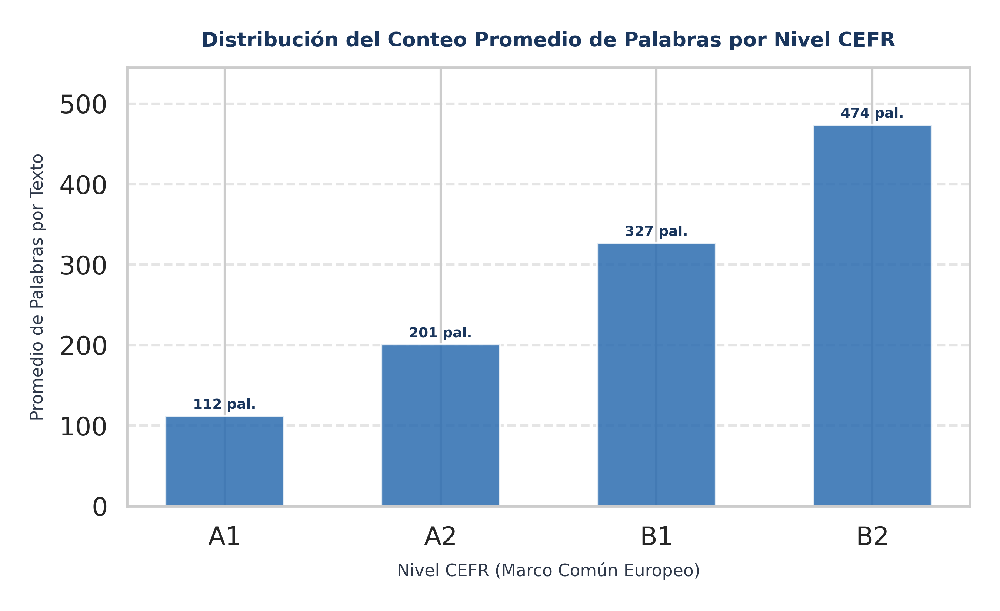
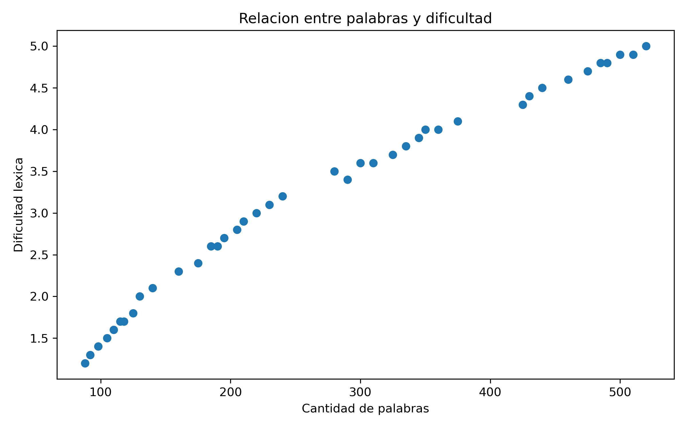
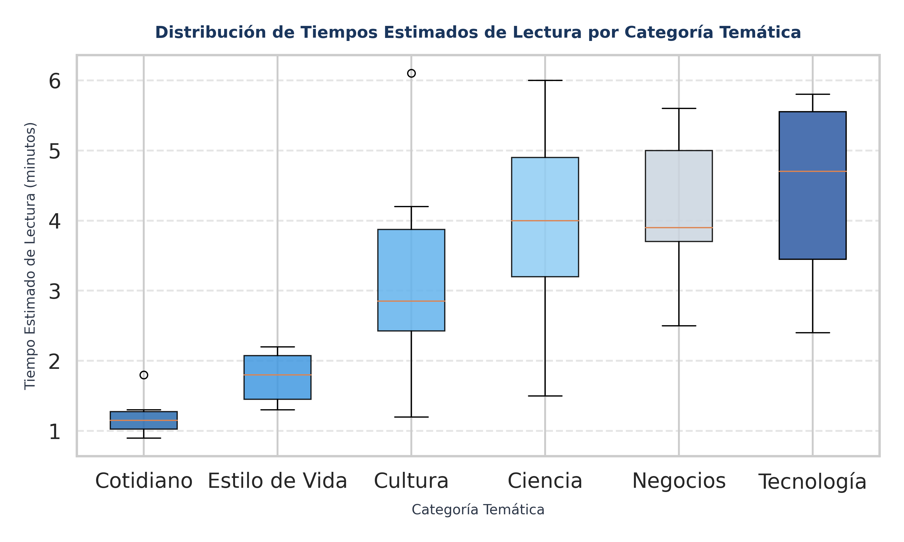
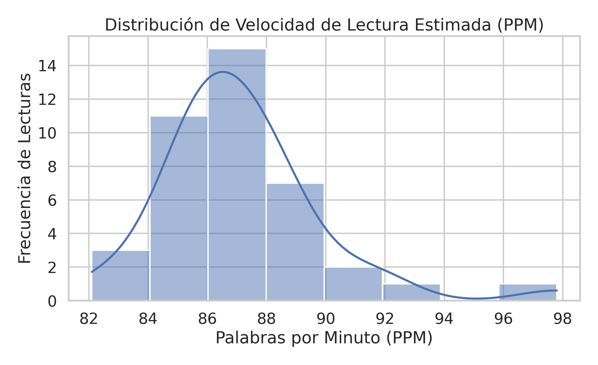
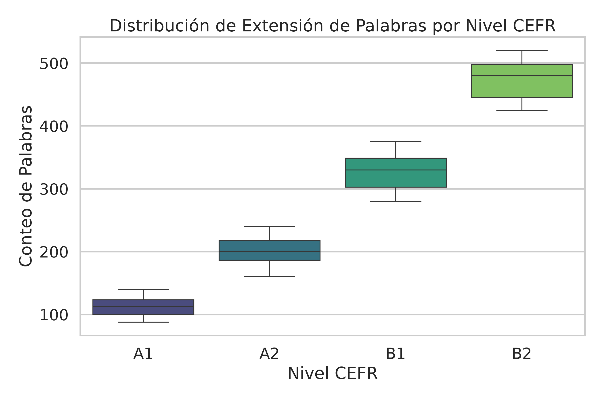
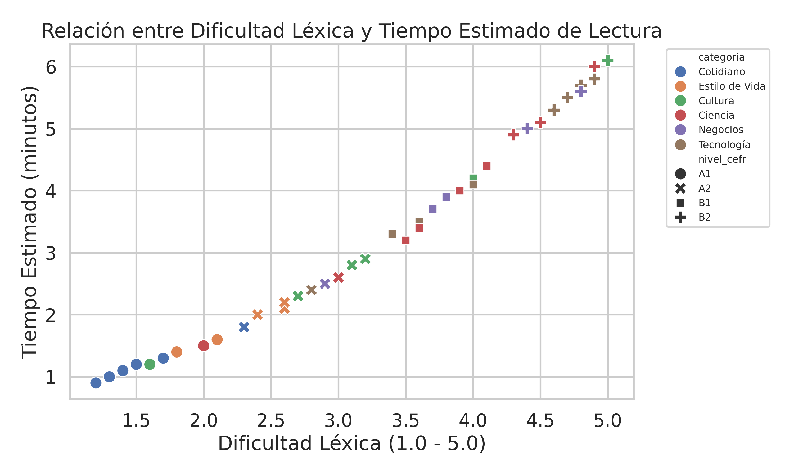

# 📚 IA_TutorIngles - Tutor Inteligente de Lectura y Comprensión en Inglés

**Asignatura:** Inteligencia Artificial (Semestre 6)  
**Institución:** Corporación de Estudios Tecnológicos del Norte del Valle (COTECNOVA) — Cartago, Valle del Cauca  
**Docente:** Jhon James Cano Sánchez  
**Equipo de Trabajo:** Jhon Esteban Molina Echavarría, Heiber Lozano Mercado  
**Repositorio GitHub:** [https://github.com/moliech/IA_TutorIngles](https://github.com/moliech/IA_TutorIngles)  

---

## 📌 Resumen Ejecutivo del Proyecto

`IA_TutorIngles` es una plataforma analítica e inteligente diseñada para evaluar la extensión en palabras, la complejidad léxica y los tiempos estimados de lectura en textos en inglés graduados según el **Marco Común Europeo de Referencia para las Lenguas (CEFR: A1 a C2)**.

El objetivo central es diagnosticar cuantitativamente el nivel de los textos para mitigar la dependencia hacia la traducción literal palabra por palabra en los estudiantes, garantizando la asignación adaptativa de lecturas de acuerdo con la capacidad lingüística del usuario.

---

## 🔗 Accesos Directos a Archivos de Interés

- 📄 **Informe Académico Completo (Primer Corte):** [Informe_Corte_1.md](Informe_Corte_1.md) | [informes/Informe_Corte_1.md](informes/Informe_Corte_1.md)
- 📊 **Informe Dinámico Exportado por Código:** [informes/informe_proyecto.md](informes/informe_proyecto.md)
- 📁 **Dataset Base Estandarizado (40 Lecturas):** [data/lecturas_ingles.csv](data/lecturas_ingles.csv)
- 🤖 **Dataset Preparado para Machine Learning:** [data/lecturas_preparadas_ml.csv](data/lecturas_preparadas_ml.csv)
- 🚀 **Orquestador Principal en Python:** [src/main.py](src/main.py)
- 🖼️ **Directorio de Visualizaciones Exportadas:** [graficos/](graficos/)

---

## 📁 Estructura del Repositorio

```text
IA_TutorIngles/
├── Dockerfile                  # Empaquetado oficial en Python 3.12-slim
├── docker-compose.yml          # Configuración del servicio contenedorizado
├── requirements.txt            # Dependencias del proyecto (numpy, pandas, matplotlib, seaborn, etc.)
├── README.md                   # Documentación ejecutiva del repositorio
├── Informe_Corte_1.md          # Informe académico completo de primer corte
├── data/
│   ├── lecturas_ingles.csv     # Dataset base estandarizado (40 lecturas)
│   └── lecturas_preparadas_ml.csv # Dataset codificado con One-Hot Encoding listo para ML
├── src/                        # Arquitectura Modular en Python
│   ├── cargar_datos.py         # Módulo 1: Ingesta de CSV y conversión a matrices
│   ├── eda_numpy.py            # Módulo 2: Estadísticas descriptivas vectorizadas (NumPy)
│   ├── visualizaciones.py      # Módulo 3: Generación de gráficos en Matplotlib
│   ├── preparacion_datos_pandas.py # Módulo 4: Análisis Pandas, Seaborn y One-Hot Encoding (Clase 8)
│   ├── generar_informe.py      # Módulo 5: Exportación del informe dinámico en Markdown
│   └── main.py                 # Orquestador central del sistema
├── graficos/                   # Visualizaciones exportadas en 300 DPI (.png)
│   ├── distribucion_cefr_palabras.png
│   ├── relacion_dificultad_extension.png
│   ├── distribucion_tiempos_categoria.png
│   ├── seaborn_distribucion_ppm.png
│   ├── seaborn_palabras_por_cefr.png
│   └── seaborn_dificultad_vs_tiempo.png
└── informes/                   # Carpeta de informes generados
    ├── Informe_Corte_1.md
    └── informe_proyecto.md
```

---

## 📊 Métricas del Análisis Exploratorio (EDA con NumPy)

| Variable Numérica | Media ($\mu$) | Mediana ($Q_2$) | Desviación Estándar ($\sigma$) | Mínimo | Máximo |
| :--- | :---: | :---: | :---: | :---: | :---: |
| **Conteo de Palabras** | 278.4 palabras | 240.0 palabras | 134.1 palabras | 85.0 palabras | 520.0 palabras |
| **Dificultad Léxica (1.0 - 5.0)** | 3.21 / 5.0 | 3.10 / 5.0 | 1.12 / 5.0 | 1.20 / 5.0 | 5.00 / 5.0 |
| **Tiempo de Lectura Estimado** | 3.10 min | 2.80 min | 1.50 min | 0.90 min | 6.10 min |

---

## 🛠️ Preparación de Datos y Análisis Avanzado con Seaborn (Clase 8)

En el marco de la **Clase 8**, se incorporó el módulo [src/preparacion_datos_pandas.py](src/preparacion_datos_pandas.py) enfocado en la manipulación con **Pandas**, visualización estadística avanzada con **Seaborn** y preparación de variables para Machine Learning:

1. **Manejo e Inspección de Valores Nulos:** Se verificó el dataset confirmando integridad total (0 valores nulos en 40 registros).
2. **Columna Derivada Creada:** 
   - `velocidad_lectura_ppm`: Mide la tasa de Palabras Por Minuto estimadas para cada lectura ($\text{PPM} = \frac{\text{Conteo de Palabras}}{\text{Tiempo Estimado (min)}}$).
3. **Codificación Categórica (One-Hot Encoding):**
   - Transformación de variables cualitativas `nivel_cefr` y `categoria` mediante `pd.get_dummies()`.
   - Exportación de la matriz codificada resultante a [data/lecturas_preparadas_ml.csv](data/lecturas_preparadas_ml.csv).
4. **Visualizaciones Estadísticas Avanzadas con Seaborn:**
   - [`graficos/seaborn_distribucion_ppm.png`](./graficos/seaborn_distribucion_ppm.png): Histograma con estimación de densidad de núcleo (KDE) de la velocidad PPM.
   - [`graficos/seaborn_palabras_por_cefr.png`](./graficos/seaborn_palabras_por_cefr.png): Diagrama de cajas (*Boxplot*) de extensión de palabras comparada por Nivel CEFR.
   - [`graficos/seaborn_dificultad_vs_tiempo.png`](./graficos/seaborn_dificultad_vs_tiempo.png): Diagrama de dispersión (*Scatterplot*) relacionando dificultad léxica y tiempo estimado por categoría temática.

---

## 🖼️ Visualizaciones Estadísticas Exportadas

El sistema genera automáticamente 6 gráficos analíticos en la carpeta `graficos/`:

### 1. Conteo Promedio de Palabras por Nivel CEFR (Matplotlib)


*Archivo exportado:* [`graficos/distribucion_cefr_palabras.png`](./graficos/distribucion_cefr_palabras.png)

---

### 2. Extensión del Texto vs Dificultad Léxica (Matplotlib)


*Archivo exportado:* [`graficos/relacion_dificultad_extension.png`](./graficos/relacion_dificultad_extension.png)

---

### 3. Tiempos Estimados de Lectura por Categoría (Matplotlib)


*Archivo exportado:* [`graficos/distribucion_tiempos_categoria.png`](./graficos/distribucion_tiempos_categoria.png)

---

### 4. Distribución de Velocidad de Lectura PPM (Seaborn)


*Archivo exportado:* [`graficos/seaborn_distribucion_ppm.png`](./graficos/seaborn_distribucion_ppm.png)

---

### 5. Extensión de Palabras por Nivel CEFR (Seaborn Boxplot)


*Archivo exportado:* [`graficos/seaborn_palabras_por_cefr.png`](./graficos/seaborn_palabras_por_cefr.png)

---

### 6. Dificultad Léxica vs Tiempo Estimado de Lectura (Seaborn Scatterplot)


*Archivo exportado:* [`graficos/seaborn_dificultad_vs_tiempo.png`](./graficos/seaborn_dificultad_vs_tiempo.png)

---

## 🛠️ Instrucciones para Clonar y Ejecutar el Proyecto

### 1. Clonación del Repositorio
```bash
git clone https://github.com/moliech/IA_TutorIngles.git
cd IA_TutorIngles
```

### 2. Opción A: Ejecución Directa con Python 3
```bash
# Instalar las librerías necesarias:
pip install -r requirements.txt

# Ejecutar el programa principal:
python3 src/main.py
```

### 3. Opción B: Ejecución Contenerizada con Docker (Recomendada)
```bash
# Construir y levantar el contenedor en segundo plano:
docker compose up -d --build

# Ejecutar el flujo principal dentro del contenedor:
docker exec -it ia-tutor-ingles python src/main.py
```
