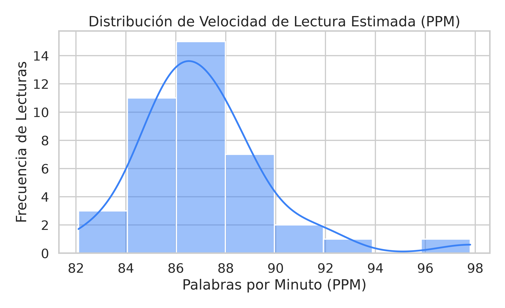
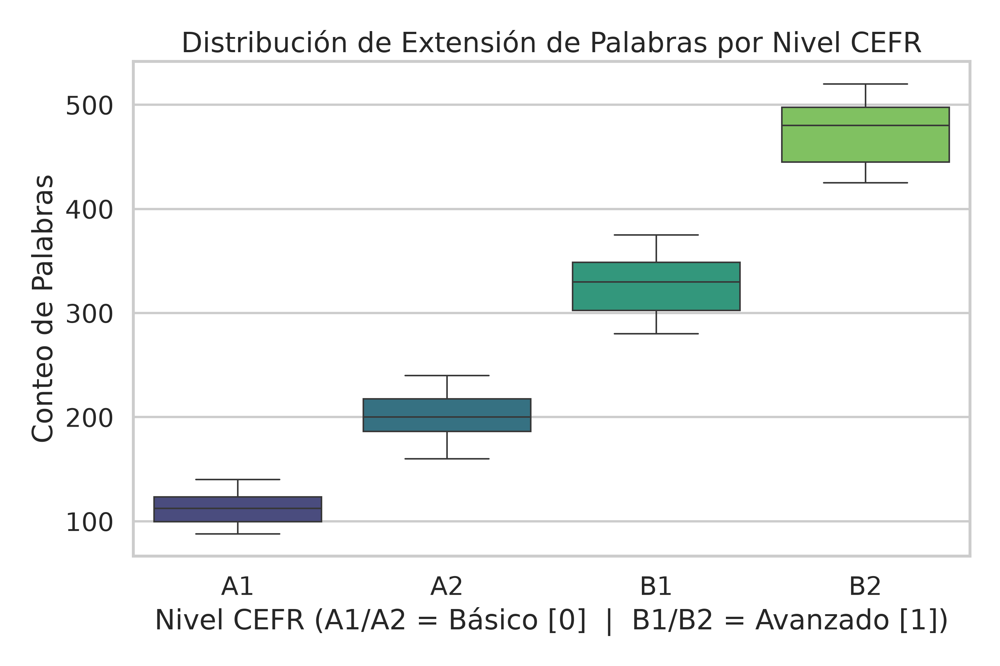
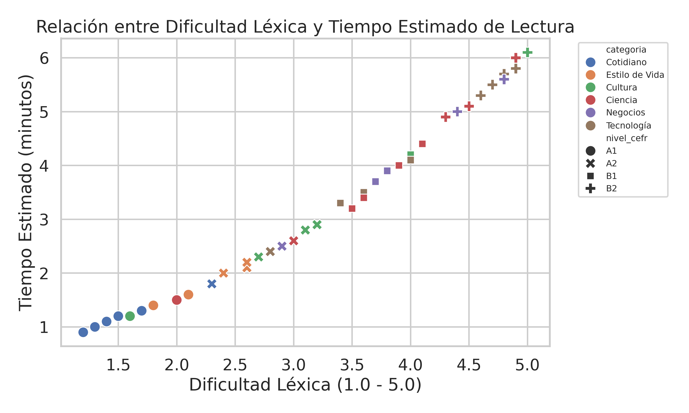
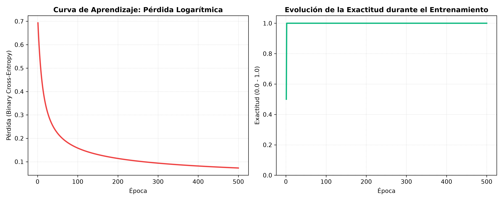
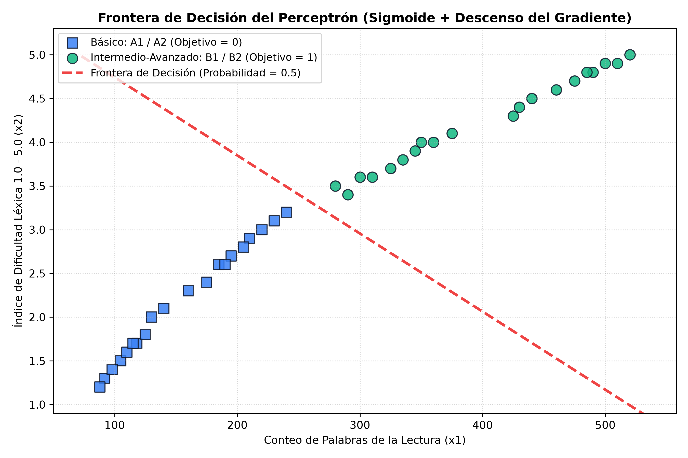
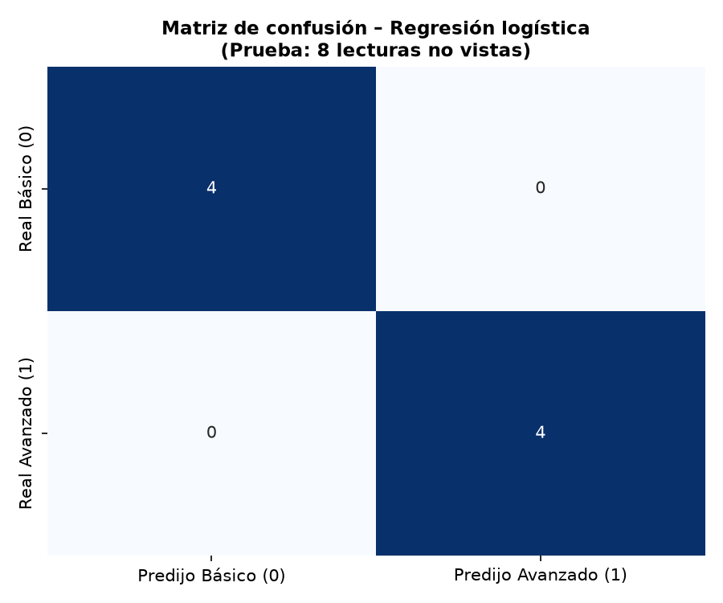

<!-- ======================================================================= -->
<!-- BORRADOR REVISADO DEL INFORME FINAL (NORMAS APA 7.ª EDICIÓN)            -->
<!-- Pendiente únicamente: número de grupo, 2 capturas de UI y export a PDF  -->
<!-- ======================================================================= -->

# PORTADA

**LexiaAdapt: Sistema Inteligente de Clasificación Lingüística y Tutoría Adaptativa de Lectura en Inglés mediante Machine Learning e IA Generativa**

  

Jhon Esteban Molina Echavarría  
Heiber Lozano Mercado

  

Programa de Ingeniería de Sistemas  
Corporación de Estudios Tecnológicos del Norte del Valle (COTECNOVA)  
Inteligencia Artificial  
Docente: Jhon James Cano Sánchez  
22 de noviembre de 2026

---

# Resumen

La enseñanza del inglés en instituciones educativas de Cartago, Valle del Cauca, enfrenta dificultades derivadas de la asignación uniforme de lecturas sin considerar el nivel real de dominio del estudiante, práctica que incentiva la traducción literal y limita la comprensión global. Este proyecto presenta el diseño, implementación y evaluación de **LexiaAdapt**, un prototipo de sistema inteligente orientado a clasificar textos en inglés entre Nivel Básico (A1/A2) y Nivel Avanzado (B1/B2) del Marco Común Europeo de Referencia (MCER), complementado con tutoría bilingüe asistida por IA generativa. A partir de un lote inicial de 46 registros, se ejecutó un flujo de depuración en Pandas que consolidó un corpus equilibrado de 40 lecturas. Se implementó desde cero un perceptrón sigmoide en NumPy entrenado sobre las 40 observaciones estandarizadas (500 épocas, pérdida final de 0.0731 y exactitud del 100 % en entrenamiento). Posteriormente, se compararon cuatro algoritmos en Scikit-Learn bajo partición estratificada 80/20 y validación cruzada (`Pipeline` con `StandardScaler`): Regresión Logística, KNN, Árbol de Decisión y `MLPClassifier`. Todos obtuvieron F1-Score de 1.00 sobre el conjunto de prueba (`n = 8`), seleccionándose la Regresión Logística por simplicidad e interpretabilidad ($w_1 = 1.64$, $w_2 = 1.50$, $b = 0.08$). El modelo serializado se desplegó en Docker y Streamlit junto con Google Gemini para auditar casos frontera. Aunque el tamaño muestral limita la generalización directa, los resultados sugieren que combinar modelos lineales interpretables con auditoría semántica constituye una estrategia prometedora para apoyar la lectura adaptativa.

**Palabras clave:** aprendizaje automático, clasificación de textos, perceptrón, regresión logística, enseñanza del inglés.

---

# 1. Introducción

El dominio del inglés como lengua extranjera representa una competencia fundamental para el acceso a literatura técnica, formación superior y oportunidades laborales en ingeniería y tecnología. Sin embargo, los indicadores nacionales y regionales evidencian brechas persistentes en el desarrollo de esta habilidad. De acuerdo con el *EF English Proficiency Index* (EF Education First, 2025), Colombia registra un nivel de dominio bajo con 480 puntos (puesto 76 entre 123 países evaluados), mientras que el Valle del Cauca alcanza 454 puntos. En el ámbito local de Cartago, los resultados de las pruebas Saber 11 del Instituto Colombiano para la Evaluación de la Educación (ICFES, 2025) reportan un promedio municipal en inglés de 55,5 puntos sobre 100, acompañado de una brecha de 27,9 puntos en el puntaje global entre establecimientos oficiales (248,5 puntos) y privados (276,4 puntos).

En este escenario educativo, los materiales de lectura en inglés suelen asignarse de forma homogénea a grupos heterogéneos, sin evaluar previamente si la extensión y la densidad léxica del texto se ajustan a la competencia real de los estudiantes. Cuando el texto supera ampliamente el nivel del lector, se produce frustración cognitiva y se consolida el hábito de traducir palabra por palabra sin comprender el sentido general del discurso. Por su parte, la graduación manual de textos según el Marco Común Europeo de Referencia (MCER) —especialmente entre niveles iniciales (A1 y A2) e intermedios o avanzados (B1 y B2)— consume tiempo docente considerable y depende de apreciaciones subjetivas.

Frente a esta problemática documentada, se justifica desarrollar un prototipo computacional reproducible que automatice la evaluación cuantitativa de lecturas en inglés, exponga con claridad los criterios matemáticos que sustentan cada clasificación y ofrezca apoyo pedagógico contextualizado. Recorrer todo el ciclo de vida de un sistema de aprendizaje automático —desde la auditoría de datos y la programación de un perceptrón desde cero hasta la validación en Scikit-Learn y su despliegue en contenedores— permite comprender el comportamiento interno del clasificador y verificar sus limitaciones reales antes de plantear su uso en aula.

Por lo anterior, el presente trabajo responde a la siguiente pregunta de investigación: **¿Cómo diseñar e implementar un sistema de clasificación supervisada reproducible y explicable que permita categorizar lecturas en inglés entre niveles Básico (A1/A2) y Avanzado (B1/B2) a partir de métricas lingüísticas cuantitativas, integrándolo en una plataforma interactiva de tutoría para el contexto educativo de Cartago?**

---

# 2. Objetivos

## 2.1. Objetivo General

Desarrollar e implementar un prototipo de sistema inteligente reproducible de clasificación y tutoría adaptativa de lecturas en inglés (**LexiaAdapt**), integrando un clasificador supervisado entrenado sobre métricas cuantitativas y una interfaz web asistida por inteligencia artificial generativa para apoyar la comprensión lectora en el contexto educativo de Cartago, Valle del Cauca.

## 2.2. Objetivos Específicos

1. Depurar y consolidar un corpus estructurado de lecturas en inglés graduadas según los niveles A1, A2, B1 y B2 del MCER mediante técnicas de limpieza, imputación estadística y análisis exploratorio de datos con NumPy, Pandas y Seaborn.
2. Implementar desde cero un perceptrón binario probabilístico con función de activación sigmoide y descenso del gradiente en NumPy, interpretando la evolución de su pérdida logarítmica, el signo de sus pesos y su frontera de decisión lineal.
3. Entrenar, evaluar y comparar cuatro modelos supervisados en Scikit-Learn (`Regresión Logística`, `KNN`, `Árbol de Decisión` y `MLPClassifier`) utilizando objetos `Pipeline`, partición estratificada y validación cruzada para seleccionar y serializar el modelo final.
4. Desplegar el modelo serializado sin reentrenamiento en un entorno reproducible con Docker y Streamlit, incorporando inferencia en tiempo real sobre textos nuevos, proyección gráfica sobre la frontera de decisión y explicabilidad pedagógica mediante la API de Google Gemini.

---

# 3. Marco Teórico

El desarrollo de **LexiaAdapt** se apoya en fundamentos del aprendizaje automático supervisado, la evaluación estadística de clasificadores, la visualización exploratoria y los principios de graduación lingüística del MCER.

## 3.1. Graduación Lingüística según el Marco Común Europeo de Referencia (MCER)

El Marco Común Europeo de Referencia establece seis niveles comunes para describir el dominio de una lengua extranjera: acceso (A1), plataforma (A2), umbral (B1), avanzado (B2), dominio operativo eficaz (C1) y maestría (C2) (Council of Europe, 2020). En comprensión lectora, los niveles A1 y A2 se caracterizan por textos breves, vocabulario cotidiano de alta frecuencia y estructuras sintácticas simples; por el contrario, los niveles B1 y B2 incorporan párrafos más extensos, conectores argumentativos y léxico técnico o abstracto. Traducir estas propiedades cualitativas a indicadores cuantitativos —como la cantidad de palabras y un índice de dificultad léxica— permite abordar la graduación de textos como un problema de clasificación supervisada.

## 3.2. El Perceptrón, Función Sigmoide y Descenso del Gradiente

El perceptrón simple, propuesto por Rosenblatt (1958), modela una neurona artificial que calcula una combinación lineal de las características de entrada $\mathbf{x} = [x_1, x_2, \dots, x_n]$ ponderadas por un vector de pesos $\mathbf{w}$ más un término de sesgo $b$:

$$z = \sum_{i=1}^{n} w_i x_i + b = \mathbf{w}^T \mathbf{x} + b$$

Para obtener salidas continuas diferenciables en clasificación binaria, la función escalón se sustituye por la **función sigmoide** (logística), la cual transforma $z \in (-\infty, +\infty)$ en una probabilidad estimada $\hat{y} \in (0, 1)$ (Géron, 2022):

$$\hat{y} = \sigma(z) = \frac{1}{1 + e^{-z}}$$

Si $\hat{y} \ge 0.5$ ($z \ge 0$), el modelo asigna la observación a la clase positiva ($1$: Avanzado); en caso contrario, a la clase negativa ($0$: Básico). Para cuantificar la discrepancia entre la probabilidad estimada y la etiqueta real $y \in \{0, 1\}$, se utiliza la **pérdida de entropía cruzada binaria** (*Binary Cross-Entropy* o *Log-Loss*) sobre $m$ observaciones (Goodfellow et al., 2016):

$$\mathcal{L}(\mathbf{w}, b) = -\frac{1}{m} \sum_{i=1}^{m} \left[ y^{(i)} \ln(\hat{y}^{(i)}) + (1 - y^{(i)}) \ln(1 - \hat{y}^{(i)}) \right]$$

El algoritmo de **descenso del gradiente** ajusta iterativamente $\mathbf{w}$ y $b$ en dirección opuesta al gradiente con una tasa de aprendizaje $\eta$:

$$\mathbf{w} \leftarrow \mathbf{w} - \eta \frac{\partial \mathcal{L}}{\partial \mathbf{w}}, \qquad b \leftarrow b - \eta \frac{\partial \mathcal{L}}{\partial b}$$

Al combinar la función sigmoide con la entropía cruzada binaria, el gradiente respecto a $z$ se simplifica a $(\hat{y}^{(i)} - y^{(i)})$, lo que favorece una convergencia numérica estable cuando las variables de entrada han sido estandarizadas.

## 3.3. Estandarización Z-Score y Prevención de Fuga de Datos

Cuando las características presentan escalas muy distintas —en este proyecto el conteo de palabras oscila entre 88 y 520, mientras la dificultad léxica varía entre 1.20 y 4.90—, la variable de mayor magnitud domina las actualizaciones del gradiente. La estandarización **Z-score** transforma cada variable para centrarla en media cero y desviación estándar unitaria:

$$x_{\text{norm}} = \frac{x - \mu}{\sigma}$$

Para evitar la **fuga de datos** (*data leakage*), los parámetros $\mu$ y $\sigma$ deben estimarse únicamente sobre los datos de entrenamiento y aplicarse luego al conjunto de prueba (Géron, 2022). El uso de objetos `Pipeline` en Scikit-Learn encapsula el escalador (`StandardScaler`) junto con el clasificador, garantizando que cada pliegue de validación y cada predicción nueva se transforme sin contaminar el entrenamiento.

## 3.4. Modelos Supervisados en Scikit-Learn y Métricas de Evaluación

El entorno del proyecto se implementó en Python 3.12 (Python Software Foundation, 2024) utilizando Scikit-Learn (Pedregosa et al., 2011) para contrastar cuatro enfoques supervisados:

1. **Regresión Logística (`LogisticRegression`):** Clasificador lineal probabilístico con regularización L2 que permite interpretar el signo e importancia relativa de cada variable.
2. **K-Vecinos Más Cercanos (`KNeighborsClassifier`):** Método basado en distancias que asigna la clase según el voto mayoritario de los $k$ vecinos más cercanos en el espacio estandarizado.
3. **Árbol de Decisión (`DecisionTreeClassifier`):** Modelo no lineal basado en reglas de corte ortogonales; su profundidad máxima se restringió (`max_depth=3`) para mitigar el sobreajuste.
4. **Perceptrón Multicapa (`MLPClassifier`):** Red neuronal artificial con capas ocultas no lineales capaz de aprender fronteras curvas.

Para evaluar el rendimiento sobre datos no vistos se emplearon la **matriz de confusión** (verdaderos positivos $VP$, verdaderos negativos $VN$, falsos positivos $FP$ y falsos negativos $FN$) y cuatro métricas:

* **Exactitud (*Accuracy*):** $\frac{VP + VN}{VP + VN + FP + FN}$.
* **Precisión (*Precision*):** $\frac{VP}{VP + FP}$.
* **Sensibilidad (*Recall*):** $\frac{VP}{VP + FN}$.
* **Puntaje F1 (*F1-Score*):** $2 \cdot \frac{\text{Precisión} \cdot \text{Recall}}{\text{Precisión} + \text{Recall}}$.

Se complementó la evaluación con **validación cruzada estratificada** de 5 pliegues sobre el conjunto de entrenamiento para verificar la estabilidad de las métricas.

## 3.5. Modelos de Lenguaje de Gran Escala como Capa de Explicabilidad

Los clasificadores lineales sobre métricas superficiales ofrecen transparencia algebraica, pero no interpretan el significado semántico de un texto. Por ello, los Modelos de Lenguaje de Gran Escala (LLM), como Google Gemini (Google, 2026), aportan una capa complementaria de **explicabilidad en lenguaje natural**, permitiendo contrastar la predicción matemática frente al contenido real del texto y brindar asistencia lingüística contextual al usuario.

---

# 4. Metodología

## 4.1. Procedencia de los Datos y Evolución del Proyecto

El conjunto de datos del proyecto fue compilado a partir de fuentes de datos abiertos (*Open Data*), principalmente repositorios públicos de clasificación de textos en Kaggle (*CEFR Levelled English Texts*) y referencias de lecturas graduadas (*Graded Readers*) del British Council y Cambridge English (Kaggle, 2024; British Council & Cambridge English, 2024). Cada registro describe una lectura mediante su identificador, título, nivel CEFR (`A1` a `B2`), conteo de palabras, dificultad léxica en escala de `1.0` a `5.0`, área temática y tiempo estimado de lectura.

Respecto al planteamiento preliminar del segundo avance, el sistema evolucionó en tres aspectos concretos que conviene dejar documentados:
1. **Denominación final:** El prototipo originalmente denominado *Tutor Virtual de Inglés Conversacional y Adaptativo* recibió el nombre comercial de **LexiaAdapt** en su interfaz final.
2. **Ampliación de modelos comparados:** Aunque en el segundo corte se proyectaba comparar Regresión Logística, Árbol de Decisión y Random Forest, en la fase final se amplió la evaluación a cuatro arquitecturas que cubren enfoques lineales, basados en distancia, basados en reglas y neuronales (`LogisticRegression`, `KNeighborsClassifier`, `DecisionTreeClassifier` y `MLPClassifier`).
3. **Delimitación del alcance funcional:** La recomendación personalizada basada en historial previo del usuario quedó fuera del alcance de esta versión inicial; el sistema se concentró en **clasificación automática de lecturas inéditas**, **consulta filtrada del catálogo base** y **tutoría bilingüe interactiva (`LexiaTutor`)**.

La Tabla 1 presenta el diccionario de variables del corpus depurado final.

**Tabla 1**  
*Diccionario de variables del dataset limpio (`data/proyecto_limpio.csv`)*

| Variable | Tipo | Descripción | Rango / Valores | Rol en el Modelo |
| :--- | :--- | :--- | :--- | :--- |
| `id` | Entero | Identificador único de la lectura | `1` a `40` | Identificación |
| `titulo` | Texto | Título de la lectura en inglés | Cadena de texto | Metadato / Interfaz |
| `categoria` | Categórica | Área temática canónica | 6 categorías únicas | Codificación ML / Filtro |
| `nivel_cefr` | Ordinal | Nivel oficial asignado según MCER | `A1`, `A2`, `B1`, `B2` | Base de etiqueta (excluida de $X$) |
| `conteo_palabras` | Entero | Extensión cuantitativa de la lectura | `88` a `520` palabras | **Característica de entrada ($x_1$)** |
| `dificultad_lexica` | Flotante | Índice de complejidad vocabular-sintáctica | `1.20` a `4.90` | **Característica de entrada ($x_2$)** |
| `tiempo_lectura_est_min` | Flotante | Tiempo estimado de lectura | `1.0` a `6.0` min | Visualización / EDA |
| `velocidad_lectura_ppm` | Flotante | Variable derivada (palabras por minuto) | $\approx 82$ a $98$ ppm | Análisis exploratorio |
| `texto_ingles` | Texto | Contenido completo de la lectura | Párrafo(s) en inglés | Lectura y análisis LLM |

*Nota.* Elaboración propia a partir de `src/preparacion_datos_pandas.py` y `data/proyecto_limpio.csv`.

## 4.2. Preparación, Limpieza y Prevención de Fuga de Datos

A partir del lote crudo inicial de **46 registros y 7 columnas** (`data/lecturas_ingles_crudo.csv`), el módulo `src/preparacion_datos_pandas.py` (McKinney, 2022) aplicó cuatro correcciones secuenciales:

1. **Normalización categórica:** Se estandarizaron 12 variantes tipográficas (espacios, mayúsculas y ausencia de tildes) hacia las 6 categorías canónicas (`Cotidiano`, `Estilo de Vida`, `Cultura`, `Ciencia`, `Negocios` y `Tecnología`).
2. **Eliminación de duplicados:** Se descartaron **3 filas repetidas** (`id` 5, 18 y 31) mediante `drop_duplicates(keep="first")`, pasando de 46 a 43 registros.
3. **Filtrado de valores atípicos imposibles:** Se eliminaron **3 registros con valores fuera de rango** (`id` 901 con -50 palabras, `id` 902 con dificultad de 9.8 y `id` 903 con 0.0 minutos), quedando **40 lecturas válidas**.
4. **Imputación por mediana agrupada:** Los **2 valores nulos** detectados (`dificultad_lexica` en el `id` 12, A2 Cultura; y `tiempo_lectura_min` en el `id` 27, B1 Cultura) se imputaron con la mediana de su mismo grupo (`nivel_cefr`, `categoria`), asignando `2.2` y `3.3` minutos respectivamente.

Además, se derivó la variable `velocidad_lectura_ppm` y se validó la codificación *One-Hot* con `pd.get_dummies()`, exportando `data/proyecto_limpio.csv` (40 lecturas balanceadas: 10 por cada nivel A1, A2, B1 y B2) y `data/lecturas_preparadas_ml.csv` (14 columnas).

Para el modelado binario se definió $y = 0$ para el **Nivel Básico (`A1/A2`, 20 lecturas)** y $y = 1$ para el **Nivel Avanzado (`B1/B2`, 20 lecturas)**. Las columnas `nivel_cefr`, `tiempo_lectura_est_min` y `velocidad_lectura_ppm` fueron excluidas de la matriz de entrada $X$, reteniendo únicamente `conteo_palabras` ($x_1$) y `dificultad_lexica` ($x_2$) para impedir la fuga de información sobre la etiqueta objetivo.

## 4.3. Entrenamiento del Perceptrón en NumPy y Pipeline en Scikit-Learn

El proyecto distingue dos etapas de entrenamiento con propósitos metodológicos diferenciados:

1. **Perceptrón desde cero (`src/perceptron_proyecto.py`):** Como ejercicio de implementación matemática y optimización, el perceptrón sigmoide se entrenó sobre las **40 observaciones estandarizadas** ($\mu_1 = 278.40, \sigma_1 = 138.56$; $\mu_2 = 3.21, \sigma_2 = 1.17$), inicializando $\mathbf{w} = [0, 0]$ y $b = 0$, con $\eta = 0.1$ durante 500 épocas. Dado que se evalúa sobre la totalidad del corpus de entrenamiento, su desempeño refleja capacidad de ajuste sobre la muestra completa, no generalización independiente.
2. **Validación formal en Scikit-Learn (`src/modelo_proyecto.py`):** Para medir capacidad predictiva real sobre casos no vistos, los 40 registros se dividieron en **32 lecturas de entrenamiento** (80 %) y **8 lecturas de prueba** (20 %) mediante `train_test_split(..., stratify=y, random_state=42)`. Cada uno de los cuatro algoritmos se encapsuló en un `Pipeline([("scaler", StandardScaler()), ("model", ...)])`, aplicando además validación cruzada estratificada de 5 pliegues (`f1_weighted`) dentro del conjunto de entrenamiento. El modelo seleccionado se serializó en `src/modelo_final.joblib`.

## 4.4. Inferencia en Vivo, Estimación Léxica y Subniveles Orientativos

El módulo `src/usar_modelo.py` carga `modelo_final.joblib` sin reentrenar para predecir nuevos textos. Cuando se ingresan lecturas inéditas en texto plano (`titulo|categoria|lectura`) desde la interfaz web (`src/app.py`), no se solicita al usuario que digite métricas numéricas manualmente; en su lugar, el sistema extrae el conteo exacto de palabras mediante expresiones regulares y estima la dificultad léxica (`1.0` a `5.0`) mediante una regresión lineal positiva (`LinearRegression(positive=True)`) ajustada previamente sobre los 40 textos del corpus limpio.

Para evitar colinealidad con la extensión del texto, dicha regresión auxiliar utilizó exclusivamente tres indicadores independientes de la longitud total:
* Longitud media de palabra en caracteres (`avg_len`).
* Proporción de palabras complejas con $\ge 9$ caracteres (`pct_long`).
* Extensión media oracional acotada a 35 palabras por oración (`avg_sent_len`).

Este modelo auxiliar alcanzó un coeficiente de determinación $R^2 = 0.859$ respecto a la columna `dificultad_lexica` del corpus base:

$$\text{dificultad\_est} = \text{clip}_{[1.0, 5.0]}\Big(-0.2177 + 0.0782 \cdot \text{avg\_len} + 3.3717 \cdot \text{pct\_long} + 0.0868 \cdot \text{avg\_sent\_len}\Big)$$

Debe subrayarse que esta fórmula produce una **aproximación cuantitativa de superficie** para alimentar el clasificador en textos no etiquetados, y no reemplaza una evaluación lingüística experta certificada.

Adicionalmente, aunque el clasificador principal predice estrictamente **dos clases** (`Básico` vs. `Avanzado`), `src/usar_modelo.py` incluye una **heurística orientativa** (`obtener_subnivel_mcer`) para sugerir cuatro subniveles (`A1`, `A2`, `B1`, `B2`) según la distancia probabilística a la frontera de decisión ($P = 50\%$). Los puntos de corte ($5\%$, $50\%$ y $92\%$) se establecieron inspeccionando el rango empírico de probabilidades arrojado por `modelo_final.joblib` sobre el corpus base: las lecturas `A1` registraron probabilidades entre $0.81\%$ y $4.54\%$; las `A2` entre $7.21\%$ y $38.71\%$; las `B1` entre $59.56\%$ y $90.77\%$; y las `B2` entre $95.82\%$ y $99.42\%$. Por consiguiente, el subnivel mostrado en pantalla constituye una guía pedagógica derivada de la confianza probabilística, no una clasificación multiclase validada de manera independiente.

## 4.5. Capa Generativa con Gemini y Contenedorización en Docker

El módulo `src/gemini_tutor.py` consume la API REST de Google Gemini (con respaldo entre `gemini-flash-lite-latest`, `gemini-3.5-flash-lite` y `gemini-3.1-flash-lite`, y clave almacenada en `.env` excluido en `.gitignore`). Esta capa no interviene en el cálculo probabilístico del clasificador, sino que cumple tres funciones de apoyo: (a) redactar un diagnóstico ejecutivo en tres bloques evaluando la coherencia entre la etiqueta matemática y el fragmento textual; (b) generar traducción y resumen guiado; y (c) operar como asistente académico formal (`LexiaTutor`). Toda la aplicación se empaquetó en Docker (`Dockerfile`, `docker-compose.yml` y `requirements.txt`) sirviendo la interfaz Streamlit en el puerto `8501`.

---

# 5. Resultados

## 5.1. Análisis Exploratorio Visual del Corpus Depurado

Tras el proceso de limpieza con Pandas, las 40 lecturas consolidadas mostraron una progresión consistente en extensión y dificultad léxica entre niveles, como detalla la Tabla 2.

**Tabla 2**  
*Distribución cuantitativa del corpus limpio por nivel MCER (`n = 40`)*

| Nivel MCER | Clase Binaria | Cantidad de Lecturas | Extensión Promedio (palabras) | Dificultad Léxica Promedio (1–5) | Tiempo Estimado Promedio (min) |
| :---: | :---: | :---: | :---: | :---: | :---: |
| **A1** | 0 (Básico) | 10 | 112.1 | 1.63 | 1.2 |
| **A2** | 0 (Básico) | 10 | 201.0 | 2.76 | 2.4 |
| **B1** | 1 (Avanzado) | 10 | 327.0 | 3.76 | 3.8 |
| **B2** | 1 (Avanzado) | 10 | 473.5 | 4.69 | 5.5 |
| **Global** | — | **40** | **278.4** | **3.21** | **3.2** |

*Nota.* Métricas calculadas sobre `data/proyecto_limpio.csv` mediante `src/eda_numpy.py`.

Para seleccionar y justificar las variables de entrada del modelo, se generaron visualizaciones estadísticas con Seaborn (Waskom, 2021). La Figura 1 muestra que la velocidad estimada de lectura (`velocidad_lectura_ppm`) se concentra entre 82 y 98 palabras por minuto (promedio cercano a 88 ppm) de forma estable en todo el corpus; por esta baja capacidad discriminativa entre niveles, se conservó como métrica descriptiva y no como variable predictora.

**Figura 1**  
*Distribución de la velocidad estimada de lectura en palabras por minuto (`velocidad_lectura_ppm`)*

*Nota.* Elaboración propia con Seaborn (`src/preparacion_datos_pandas.py`).

Por su parte, la Figura 2 evidencia un incremento progresivo claro en el conteo de palabras desde A1 hasta B2, separando sin solapamiento el bloque básico (A1/A2) del bloque avanzado (B1/B2). La Figura 3 confirma la relación lineal positiva entre dificultad léxica y tiempo estimado de lectura, mostrando que los textos básicos se concentran hasta dificultad `3.2` y los avanzados a partir de `3.4`, lo que respaldó la selección de `conteo_palabras` y `dificultad_lexica` como variables de entrada.

**Figura 2**  
*Distribución de la extensión en palabras por nivel MCER*

*Nota.* Elaboración propia con Seaborn (`src/preparacion_datos_pandas.py`).

**Figura 3**  
*Relación entre dificultad léxica y tiempo estimado de lectura por nivel y categoría*

*Nota.* Elaboración propia con Seaborn (`src/preparacion_datos_pandas.py`).

## 5.2. Convergencia del Perceptrón desde Cero (NumPy)

El perceptrón implementado desde cero redujo su pérdida de entropía cruzada desde `0.6931` (inicialización en ceros) hasta `0.0731` tras completar las 500 épocas, alcanzando una exactitud del **100.00 % (40/40)** sobre el conjunto completo de entrenamiento (Tabla 3 y Figura 4). La Figura 5 muestra la frontera lineal aprendida sobre el plano de lecturas.

**Tabla 3**  
*Evolución del entrenamiento del perceptrón probabilístico en NumPy (`n = 40`)*

| Época | Pérdida (Pre-actualización) | Exactitud | Peso $w_1$ (Palabras) | Peso $w_2$ (Dificultad) | Sesgo $b$ |
| :---: | :---: | :---: | :---: | :---: | :---: |
| **1** | 0.6931 | 50.00 % | 0.0440 | 0.0435 | 0.0000 |
| **100** | 0.1583 | 100.00 % | 1.4104 | 1.3699 | 0.0279 |
| **200** | 0.1139 | 100.00 % | 1.8896 | 1.8170 | 0.0636 |
| **300** | 0.0939 | 100.00 % | 2.2177 | 2.1164 | 0.0919 |
| **400** | 0.0817 | 100.00 % | 2.4764 | 2.3484 | 0.1146 |
| **500** | 0.0732 | **100.00 %** | **2.6936** | **2.5407** | **0.1333** |

*Nota.* Salida de `src/perceptron_proyecto.py`. En cada época, la pérdida impresa se evalúa antes de aplicar el paso de gradiente; al evaluar los pesos finales tras la época 500, la pérdida final consolidada es `0.0731`.

**Figura 4**  
*Curva de aprendizaje (pérdida logarítmica y exactitud) del perceptrón en NumPy*

*Nota.* Elaboración propia con Matplotlib (`src/perceptron_proyecto.py`).

**Figura 5**  
*Frontera de decisión lineal aprendida por el perceptrón sobre el corpus estandarizado*

*Nota.* Elaboración propia con Matplotlib (`src/perceptron_proyecto.py`).

## 5.3. Comparación de Modelos en Scikit-Learn y Selección Final

Al evaluar los cuatro modelos encapsulados en `Pipeline` sobre las 8 lecturas reservadas para prueba (4 Básicas y 4 Avanzadas), todos obtuvieron métricas de `1.00` tanto en prueba como en validación cruzada de 5 pliegues (Tabla 4 y Figura 6).

**Tabla 4**  
*Comparación de modelos supervisados en Scikit-Learn (`train = 32`, `test = 8`)*

| Modelo | Exactitud (Test) | Precisión (Test) | Recall (Test) | F1-Score (Test) | Val. Cruzada (Train) |
| :--- | :---: | :---: | :---: | :---: | :---: |
| **Regresión Logística** | **1.00** | **1.00** | **1.00** | **1.00** | **1.00** |
| KNN (5 vecinos) | 1.00 | 1.00 | 1.00 | 1.00 | 1.00 |
| Árbol de Decisión (`max_depth=3`) | 1.00 | 1.00 | 1.00 | 1.00 | 1.00 |
| Red Neuronal (`MLPClassifier`) | 1.00 | 1.00 | 1.00 | 1.00 | 1.00 |

*Nota.* Resultados impresos por `src/modelo_proyecto.py` bajo partición estratificada 80/20 (`random_state=42`).

**Figura 6**  
*Matriz de confusión en el conjunto de prueba de Scikit-Learn (`n = 8`)*

*Nota.* Elaboración propia (`src/modelo_proyecto.py`): 4 verdaderos negativos (Básico) y 4 verdaderos positivos (Avanzado), sin falsos positivos ni falsos negativos.

Se eligió la **Regresión Logística** como modelo final (`src/modelo_final.joblib`) por dos razones principales: requiere menor complejidad que `MLPClassifier` o `KNN` obteniendo idéntico rendimiento en prueba, y permite inspeccionar directamente los pesos aprendidos ($w_1 = +1.64$, $w_2 = +1.50$, $b = +0.08$). Al contrastar estos parámetros con el perceptrón en NumPy ($w_1 = +2.6936$, $w_2 = +2.5407$, $b = +0.1333$), debe considerarse que ambos modelos no comparten idéntico conjunto ni esquema de optimización (32 registros con regularización L2 frente a 40 registros sin regularización), por lo cual sus magnitudes absolutas no son comparables de forma directa. No obstante, ambos coinciden en el **signo positivo** y en una **importancia relativa equilibrada** entre extensión y dificultad léxica.

## 5.4. Inferencia en Vivo sobre Lecturas Inéditas y Plataforma Web

Para verificar el comportamiento de `modelo_final.joblib` sin reentrenamiento frente a lecturas inéditas, se evaluaron casos nuevos mediante `src/usar_modelo.py` y la interfaz web **LexiaAdapt** (Tabla 5). Las evidencias visuales de la plataforma en ejecución (clasificador por lotes, diagnóstico generativo, lector bilingüe y proyección en la frontera) se presentan en el Apéndice B.

**Tabla 5**  
*Resultados de inferencia en vivo sobre lecturas inéditas cargadas en formato plano*

| Título de la Lectura (Inédita) | Palabras Calculadas | Dificultad Estimada (1–5) | Prob. Avanzado (%) | Clasificación Binaria | Subnivel Orientativo |
| :--- | :---: | :---: | :---: | :--- | :--- |
| *My Daily Morning Routine* | 99 | 1.42 | 1.2 % | Básico (A1/A2) | A1 (Básico inicial) |
| *A Visit to the Local Supermarket* | 172 | 2.94 | 16.9 % | Básico (A1/A2) | A2 (Básico consolidado) |
| *Clean Energy Transition along the River Valley* | 190 | 4.04 | 50.6 % | Avanzado (B1/B2) | B1 (Intermedio frontera) |
| *Sustainable Renewable Energy Systems* | 219 | 4.18 | 63.3 % | Avanzado (B1/B2) | B1 (Intermedio frontera) |
| *Artificial Intelligence in Clinical Oncology* | 299 | 4.97 | 92.4 % | Avanzado (B1/B2) | B2 (Avanzado pleno) |
| *Quantum Computing Principles* *(caso frontera)* | 127 | 4.19 | 37.0 % | Básico (A1/A2) | A2 (Sesgo por brevedad) |

*Nota.* Métricas calculadas automáticamente desde el texto plano por `src/app.py` e inferidas por `src/usar_modelo.py`.

---

# 6. Discusión

## 6.1. Interpretación de Resultados en el Contexto de Cartago

Los resultados sugieren que la combinación de extensión textual y dificultad léxica permite modelar la separación entre textos básicos (A1/A2) e intermedio-avanzados (B1/B2) dentro de un corpus graduado. En el contexto educativo de Cartago —donde los puntajes de Saber 11 reflejan brechas de desempeño entre instituciones oficiales y privadas—, disponer de una herramienta web que evalúa textos en segundos y ofrece apoyo bilingüe con resumen guiado y tutoría formal (`LexiaTutor`) puede ayudar a los docentes a seleccionar lecturas acordes al nivel de cada grupo y reducir la dependencia estudiantil hacia la traducción palabra por palabra.

## 6.2. Limitaciones Técnicas, Tamaño Muestral y Sesgo de Brevedad

Un análisis crítico del sistema identifica tres limitaciones que deben considerarse antes de cualquier adopción amplia:

1. **Muestra reducida y separabilidad marcada:** El desempeño perfecto ($F_1 = 1.00$) tanto en validación cruzada como en las 8 observaciones de prueba obedece a que el corpus base de 40 lecturas presenta una separación pronunciada entre sus niveles (por ejemplo, A1 promedia 112 palabras frente a 473 en B2). Una muestra de prueba de 8 lecturas es insuficiente para afirmar generalización universal ante textos auténticos heterogéneos.
2. **Sesgo hacia la extensión en textos cortos densos:** El caso de control *Quantum Computing Principles and Cryptographic Paradigms* (Tabla 5) ilustra una debilidad estructural del modelo lineal. Aunque la fórmula auxiliar estimó una dificultad léxica elevada ($4.19 / 5.0$), su extensión breve (127 palabras) desplazó la combinación lineal por debajo de la frontera de decisión ($P = 37.0\%$), clasificándolo como Básico (A1/A2). Esto ocurre porque en el corpus de entrenamiento los textos avanzados superan mayoritariamente las 250 palabras. De forma inversa, un texto muy largo pero con vocabulario elemental repetitivo tendería a ser clasificado como Avanzado únicamente por su extensión.
3. **Rol de la auditoría semántica con Gemini:** Precisamente frente a esa limitación, la capa generativa cumplió la función de auditar la predicción matemática: al analizar el fragmento de *Quantum Computing*, Gemini señaló la inconsistencia entre la etiqueta A1/A2 y la alta densidad científica del texto, recomendando descartarlo para principiantes y reservarlo para niveles superiores.

## 6.3. Consideraciones Éticas y Privacidad

El sistema implementa tres resguardos éticos y operativos: (a) las credenciales de la API de Google Gemini se gestionan exclusivamente en `.env` (ignorado por Git), evitando su exposición en el repositorio; (b) los diagnósticos generados por IA y los subniveles heurísticos se presentan como recomendaciones orientativas que no sustituyen el criterio profesional del docente; y (c) el procesamiento de archivos planos nuevos se ejecuta en memoria de sesión sin persistir datos personales de estudiantes.

---

# 7. Conclusiones y Trabajo Futuro

## 7.1. Conclusiones

1. Se completó el ciclo integral de desarrollo solicitado en la asignatura, consolidando a **LexiaAdapt** como un **prototipo funcional con potencial de aplicación pedagógica**, cuyo uso en escenarios educativos reales requerirá ampliar el corpus de entrenamiento y realizar validaciones piloto con docentes y estudiantes.
2. El flujo de preparación en Pandas resolvió duplicados, categorías inconsistentes, valores fuera de rango e imputación de nulos sin introducir fuga de información, estableciendo una base limpia de 40 lecturas.
3. El perceptrón en NumPy logró converger sobre los datos estandarizados ($0.6931 \to 0.0731$ en 500 épocas, 100 % de exactitud sobre el conjunto de entrenamiento), y la comparativa en Scikit-Learn confirmó la viabilidad de la Regresión Logística ($F_1 = 1.00$ en las 8 observaciones de prueba) bajo una estructura lineal interpretable.
4. La integración de inferencia sin reentrenamiento (`src/usar_modelo.py`), cálculo automático de métricas lingüísticas, visualización en Docker y auditoría semántica con Google Gemini demostró cómo una segunda capa de IA generativa ayuda a detectar y explicar fallos del modelo lineal en casos frontera.

## 7.2. Trabajo Futuro

1. **Ampliación del corpus con textos reales locales:** Recolectar entre 300 y 500 lecturas auténticas empleadas en colegios e instituciones de Cartago para evaluar los modelos en condiciones de mayor solapamiento y variabilidad.
2. **Incorporación de representaciones semánticas (TF-IDF / *Embeddings*):** Combinar vectores semánticos con las métricas cuantitativas para eliminar el sesgo por longitud en textos breves de alta complejidad técnica.
3. **Evaluación empírica en aula:** Realizar pruebas piloto con docentes y estudiantes para validar si los umbrales heurísticos de subnivel y la asistencia bilingüe mejoran efectivamente la comprensión lectora.
4. **Módulo de recomendación personalizada y audio:** Retomar la recomendación adaptativa por historial de usuario e integrar síntesis de voz (TTS) para fortalecer la comprensión auditiva.

---

# Referencias

British Council & Cambridge English. (2024). *Graded readers and CEFR level descriptors* [Guía pedagógica]. https://www.cambridgeenglish.org/

Council of Europe. (2020). *Common European Framework of Reference for Languages: Learning, teaching, assessment – Companion volume*. Council of Europe Publishing. https://rm.coe.int/common-european-framework-of-reference-for-languages-learning-teaching/16809ea0d4

EF Education First. (2025). *EF English Proficiency Index (EF EPI) — Edición 2025: Resultados para Colombia y Valle del Cauca*. https://www.ef.com/epi/

Géron, A. (2022). *Hands-on machine learning with Scikit-Learn, Keras, and TensorFlow* (3rd ed.). O'Reilly Media.

Goodfellow, I., Bengio, Y., & Courville, A. (2016). *Deep learning*. MIT Press. https://www.deeplearningbook.org/

Google. (2026). *Gemini API documentation* [Modelo de lenguaje de gran tamaño]. Google AI for Developers. https://ai.google.dev/

Instituto Colombiano para la Evaluación de la Educación [ICFES]. (2025). *Reporte de resultados municipales del examen Saber 11 (Cartago, Valle del Cauca)*. ICFES.

Kaggle. (2024). *CEFR levelled English texts dataset* [Conjunto de datos]. https://www.kaggle.com/

McKinney, W. (2022). *Python for data analysis: Data wrangling with pandas, NumPy, and Jupyter* (3rd ed.). O'Reilly Media.

Pedregosa, F., Varoquaux, G., Gramfort, A., Michel, V., Thirion, B., Grisel, O., Blondel, M., Prettenhofer, P., Weiss, R., Dubourg, V., Vanderplas, J., Passos, A., Cournapeau, D., Brucher, M., Perrot, M., & Duchesnay, É. (2011). Scikit-learn: Machine learning in Python. *Journal of Machine Learning Research*, *12*, 2825–2830.

Python Software Foundation. (2024). *Python* (Versión 3.12) [Software]. https://www.python.org

Rosenblatt, F. (1958). The perceptron: A probabilistic model for information storage and organization in the brain. *Psychological Review*, *65*(6), 386–408.

Waskom, M. L. (2021). seaborn: statistical data visualization. *Journal of Open Source Software*, *6*(60), 3021. https://doi.org/10.21105/joss.03021

---

# Apéndices

## Apéndice A. Enlace al Repositorio y Estructura de Módulos

* **Repositorio público en GitHub:** https://github.com/moliech/IA_TutorIngles
* **Módulos principales implementados:**
  * `src/preparacion_datos_pandas.py`: Limpieza, imputación por mediana agrupada, codificación *One-Hot* y gráficos Seaborn.
  * `src/perceptron_proyecto.py`: Perceptrón sigmoide desde cero en NumPy con descenso del gradiente.
  * `src/modelo_proyecto.py`: Comparativa de 4 modelos Scikit-Learn en `Pipeline`, matriz de confusión y exportación a `modelo_final.joblib`.
  * `src/usar_modelo.py`: Inferencia en vivo sin reentrenar, heurística orientativa MCER y proyección gráfica sobre la frontera de decisión.
  * `src/gemini_tutor.py`: Capa de explicabilidad ejecutiva, traducción bilingüe y tutoría formal (`LexiaTutor`).
  * `src/app.py`: Interfaz web en Streamlit empaquetada en Docker.

## Apéndice B. Evidencias Visuales de la Interfaz Web LexiaAdapt

*(Espacio reservado para incrustar las capturas de pantalla definitivas de la aplicación ejecutándose en Docker en `http://localhost:8501`:)*

* **Figura B1.** *Módulo de evaluación de nuevas lecturas, tabla de clasificación, diagnóstico con Google Gemini y lector bilingüe interactivo.*
* **Figura B2.** *Mapa de proyección de lecturas nuevas (estrellas doradas) sobre la frontera de decisión y matriz de rendimiento.*

## Apéndice C. Declaración de Uso de Inteligencia Artificial

En cumplimiento de las directrices de integridad académica del curso, se declara el uso de herramientas de Inteligencia Artificial Generativa como apoyo técnico durante el desarrollo del proyecto:

1. **Herramienta utilizada:** Antigravity / Google Gemini (modelos de asistencia para programación y procesamiento de lenguaje natural).
2. **Tareas asistidas:**
   * Depuración de manejo de estado en Streamlit (`st.file_uploader` y recarga dinámica de módulos) y ajuste de la regresión auxiliar libre de colinealidad para estimar dificultad léxica.
   * Estructuración de estilos CSS/HTML en `src/ui_theme.py` y `src/app.py`.
   * Integración de la API REST de Google Gemini en `src/gemini_tutor.py` para generar diagnósticos ejecutivos, resúmenes en tres puntos y traducción contextual en tiempo real.
   * Apoyo en revisión editorial de redacción y consistencia documental del informe.
3. **Verificación y autoría:** Todo el código, las ecuaciones, las tablas de métricas y las figuras fueron ejecutados y verificados directamente por los autores dentro del contenedor Docker (`ia-tutor-ingles`), contrastando las cifras contra `data/proyecto_limpio.csv` y las salidas reales de `src/perceptron_proyecto.py`, `src/modelo_proyecto.py` y `src/usar_modelo.py`. Los integrantes asumen plena responsabilidad sobre el funcionamiento del sistema y la sustentación de cada componente.
