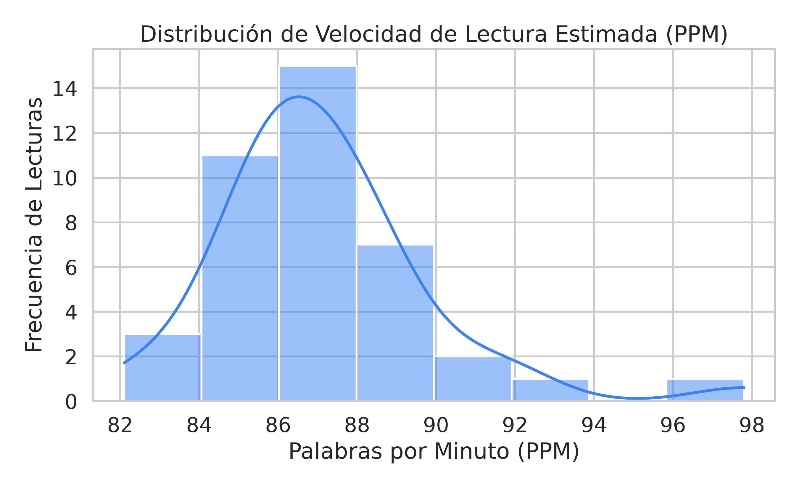
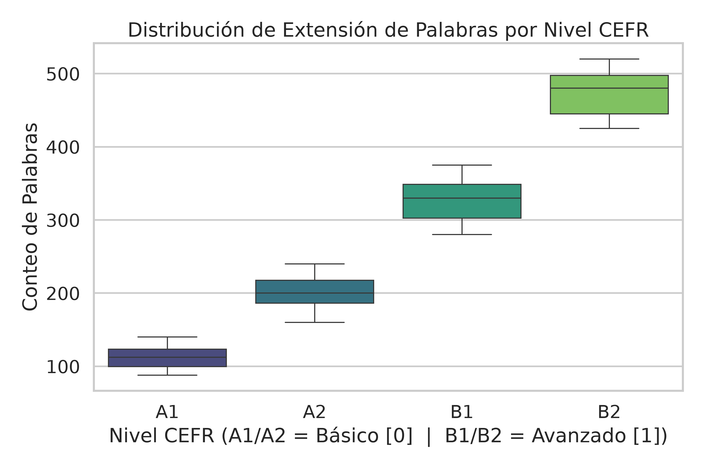
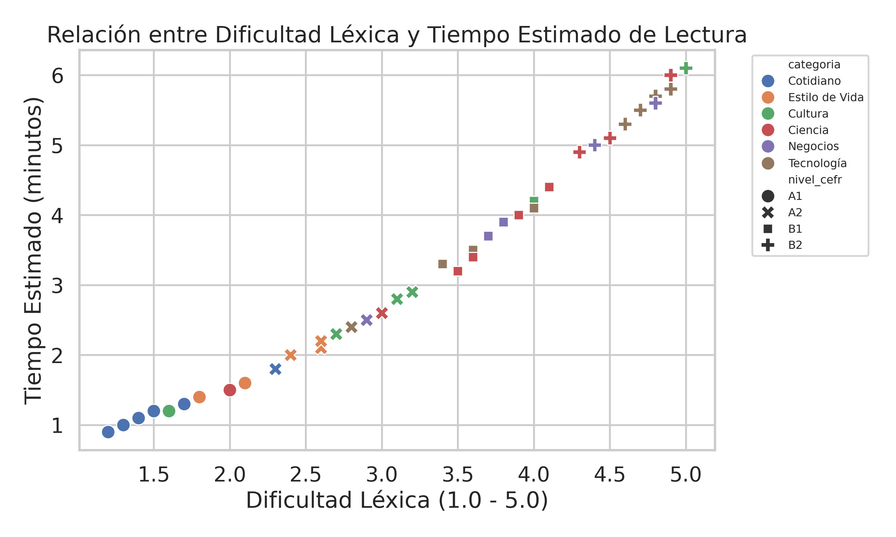
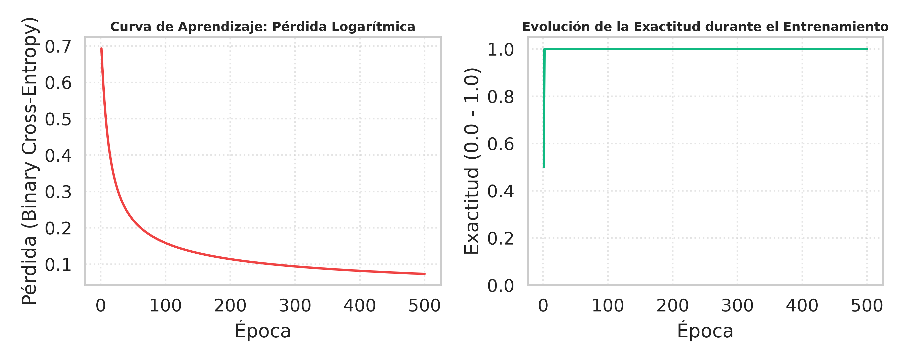
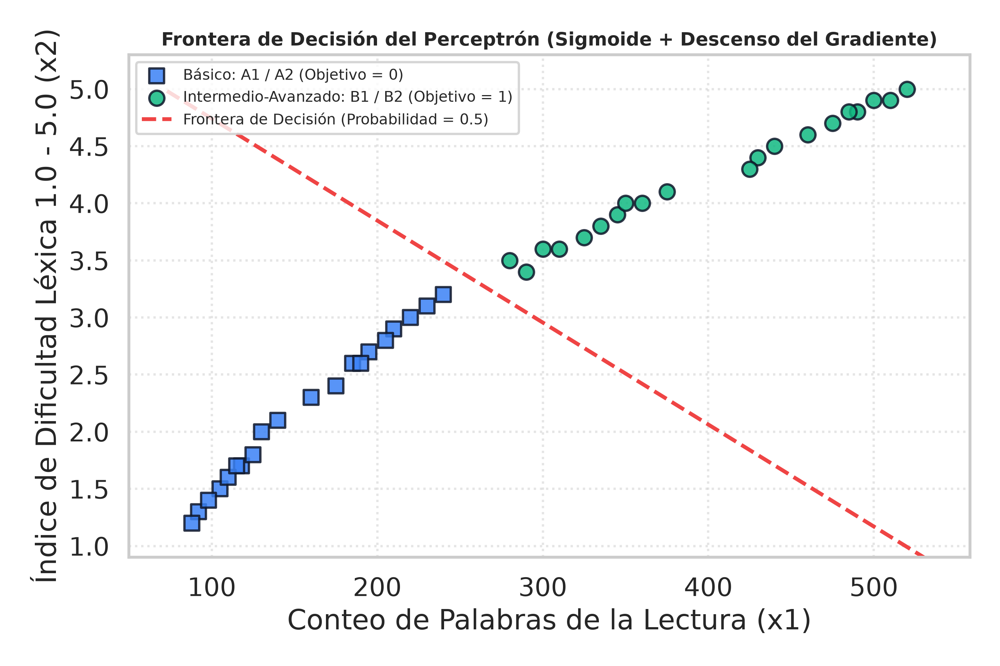

# Tutor Virtual de Inglés Adaptativo (`IA_TutorIngles`)

**Enlace al repositorio:** [https://github.com/moliech/IA_TutorIngles](https://github.com/moliech/IA_TutorIngles)  
**Video de sustentación (Avance 2):** [Google Drive](https://drive.google.com/drive/folders/154DKFAKOyDlauuwDyoacq1mFkrTdBTYA?usp=drive_link)

**Integrantes:**  
Jhon Esteban Molina Echavarría  
Heiber Lozano Mercado  

**Institución:**  
Unidad de Ingeniería, Arquitectura, Urbanismo y Afines  
Corporación de Estudios Tecnológicos del Norte del Valle (COTECNOVA)  

**Programa:**  
Tecnología en Gestión de Sistemas de Información / Ingeniería de Sistemas  

**Asignatura:**  
Inteligencia Artificial  

**Docente:**  
Prof. Jhon James Cano Sánchez  

**Fecha:**  
25 de octubre de 2026  

---

## 1. Resumen del proyecto

### Problemática local en Cartago, Valle del Cauca
El dominio del inglés es una competencia relevante para acceder a oportunidades académicas y profesionales. Sin embargo, según el *EF English Proficiency Index (2025)*, Colombia mantiene un nivel de dominio bajo (480 puntos, puesto 76 entre 123 países), y el Valle del Cauca registra 454 puntos. En Cartago, los resultados de las pruebas Saber 11 (ICFES, 2025) muestran un promedio en inglés de 55,5 puntos sobre 100, además de una brecha de 27,9 puntos en el puntaje global entre establecimientos oficiales (248,5 puntos) y privados (276,4 puntos). En este contexto, los materiales de lectura suelen asignarse de manera general al grupo, sin considerar que los estudiantes tienen diferentes niveles de dominio. Esto genera un desajuste entre la dificultad del texto y la competencia real de cada estudiante.

### Objetivo del sistema de Inteligencia Artificial
Desarrollar un Tutor Virtual de Inglés Conversacional y Adaptativo asistido por Inteligencia Artificial, capaz de clasificar automáticamente el nivel de dificultad de lecturas en inglés según el Marco Común Europeo de Referencia (CEFR), estimar variables asociadas a su complejidad y recomendar contenidos de acuerdo con el nivel e intereses del estudiante en Cartago, Valle del Cauca.

### Datos utilizados
El proyecto utiliza un corpus de lecturas graduadas en inglés almacenado en la carpeta `data/` del repositorio. Este conjunto fue compilado a partir de fuentes de datos abiertos (*Open Data*), principalmente repositorios de clasificación de textos de Kaggle (*CEFR Levelled English Texts*) y referencias de lecturas graduadas (*Graded Readers* del British Council y Cambridge English). Cada registro describe una lectura mediante su identificador (`id`), título (`titulo`), nivel CEFR (`nivel_cefr`: A1, A2, B1 y B2), cantidad de palabras (`conteo_palabras`), complejidad del vocabulario (`dificultad_lexica` en escala de 1,0 a 5,0), área temática (`categoria`) y tiempo estimado de lectura en minutos (`tiempo_lectura_min`).

---

## 2. Ajustes desde el Avance 1

A partir de las observaciones recibidas en la sustentación del Primer Corte (21 de septiembre de 2026) y de los requisitos del Segundo Corte, se realizaron tres ajustes en el proyecto:

1. **Implementación de un flujo de limpieza sobre datos crudos:** En el primer avance se trabajó directamente con una versión ya depurada del corpus (`data/lecturas_ingles.csv`) leída mediante la librería estándar `csv` y `NumPy`. Para este segundo avance se incorporó el archivo original sin procesar `data/lecturas_ingles_crudo.csv` (46 registros), que contiene inconsistencias de captura como duplicados, valores faltantes, registros inválidos y nombres de categorías escritos de distintas formas. Sobre este archivo se desarrolló el flujo de procesamiento (*pipeline*) en `src/preparacion_datos_pandas.py`, el cual genera el archivo limpio `data/proyecto_limpio.csv` (40 registros).
2. **Creación de una variable derivada y codificación categórica:** Se calculó la columna `velocidad_lectura_ppm` (palabras por minuto estimadas) para complementar el análisis exploratorio. También se aplicó codificación *One-Hot Encoding* mediante `pd.get_dummies`, una técnica que transforma las variables categóricas en columnas binarias (`0` y `1`) para que puedan utilizarse en modelos matemáticos.
3. **Definición del alcance de la clasificación para el primer modelo:** El objetivo general del proyecto y la fuente de datos se mantienen respecto al primer corte. No obstante, para entrenar el primer modelo lineal desde cero (`src/perceptron_proyecto.py`), se agruparon los niveles del corpus en dos clases: **Nivel Básico (`0`: niveles A1 y A2)** y **Nivel Intermedio-Avanzado (`1`: niveles B1 y B2)**.

---

## 3. Preparación de datos con Pandas

El flujo de procesamiento para cargar, inspeccionar, limpiar y exportar el conjunto de datos se implementó en el archivo `src/preparacion_datos_pandas.py` utilizando la librería `Pandas`.

### 3.1. Carga e inspección inicial del dataset crudo
Al cargar el lote crudo y revisarlo mediante las funciones `df.shape`, `df.info()`, `df.isnull().sum()` y `df.duplicated().sum()`, se observó una estructura inicial de **46 filas y 7 columnas**. Durante la inspección se identificaron cuatro tipos de problemas:

- **Categorías escritas de forma inconsistente:** La columna `categoria` presentaba variaciones de mayúsculas, espacios adicionales y ausencia de tildes (por ejemplo: `"tecnologia"`, `"  Tecnologia  "`, `"Tecnología"`, `"CIENCIA"` o `"estilo de vida"`). Esto hacía que las 6 temáticas del proyecto aparecieran divididas en 12 etiquetas diferentes.
- **Filas duplicadas:** Se encontraron **3 registros repetidos** (`id` 5, 18 y 31).
- **Valores atípicos o imposibles:** Se detectaron **3 registros con valores fuera de rango** para el contexto del problema (`id` 901 con `-50` palabras, `id` 902 con dificultad léxica de `9,8` en una escala de `1,0` a `5,0`, e `id` 903 con tiempo de lectura igual a `0,0` minutos).
- **Valores nulos:** Se identificaron **2 datos faltantes (`NaN`)**: uno en la columna `dificultad_lexica` (`id` 12, nivel A2) y otro en `tiempo_lectura_min` (`id` 27, nivel B1).

### 3.2. Tratamiento justificado de los problemas encontrados
Cada anomalía se corrigió siguiendo un orden lógico dentro del script:

1. **Estandarización de categorías:** Se eliminaron los espacios en blanco a los lados (`.str.strip()`), se pasó el texto a minúsculas y se aplicó un diccionario de reemplazo para unificar las variantes en las 6 categorías definidas: `Cotidiano`, `Estilo de Vida`, `Cultura`, `Ciencia`, `Negocios` y `Tecnología`.
2. **Eliminación de duplicados:** Se utilizó `df.drop_duplicates(keep="first")` para conservar únicamente la primera aparición de cada registro repetido. Con este paso el conjunto pasó de 46 a 43 filas.
3. **Filtrado de valores imposibles:** Se aplicó un filtro para conservar únicamente las lecturas con `conteo_palabras > 0`, `dificultad_lexica` entre `1,0` y `5,0`, y `tiempo_lectura_min > 0` (manteniendo temporalmente las dos filas con valores nulos para tratarlas en el paso siguiente). Así se descartaron los 3 registros inválidos, quedando 40 filas.
4. **Imputación de valores nulos:** En lugar de eliminar las dos lecturas con datos faltantes, se reemplazaron los valores nulos por la mediana correspondiente a su nivel CEFR y categoría temática. Esta decisión permitió conservar los registros y considerar las diferencias entre los grupos. De esta manera, la dificultad faltante del registro `id` 12 (A2, Cultura) se completó con `2,2` y el tiempo de lectura del registro `id` 27 (B1, Cultura) se completó con `3,3` minutos.
5. **Variable derivada y codificación con `pd.get_dummies`:** Se agregó la columna `velocidad_lectura_ppm` dividiendo la cantidad de palabras entre el tiempo estimado de lectura. Posteriormente, se verificó la transformación de las columnas categóricas a variables binarias con `pd.get_dummies(df, columns=["categoria", "nivel_cefr"], drop_first=True)`, y se exportó el conjunto limpio de 40 lecturas al archivo `data/proyecto_limpio.csv`.

```python
# Fragmento de src/preparacion_datos_pandas.py: filtrado e imputación de nulos
condicion_valida = (
    (df["conteo_palabras"] > 0)
    & ((df["dificultad_lexica"].isna()) | ((df["dificultad_lexica"] >= 1.0) & (df["dificultad_lexica"] <= 5.0)))
    & ((df["tiempo_lectura_min"].isna()) | (df["tiempo_lectura_min"] > 0))
)
df = df[condicion_valida].copy()

for col_nula in ["dificultad_lexica", "tiempo_lectura_min"]:
    df[col_nula] = df[col_nula].fillna(
        df.groupby(["nivel_cefr", "categoria"])[col_nula].transform("median")
    )
```

### 3.3. Comparación del dataset antes y después de la limpieza

La **Tabla 1** resume los cambios en el conjunto de datos tras aplicar el flujo de preparación con Pandas.

**Tabla 1.** *Estado del conjunto de datos antes (`lecturas_ingles_crudo.csv`) y después (`proyecto_limpio.csv`) de la limpieza.*

| Métrica / Indicador | Antes (Crudo) | Después (Limpio) | Tratamiento aplicado |
| :--- | :---: | :---: | :--- |
| **Número de filas** | 46 | 40 | Eliminación de 3 duplicados y 3 registros inválidos |
| **Número de columnas** | 7 | 8 (14 con `get_dummies`) | Adición de la variable `velocidad_lectura_ppm` |
| **Valores nulos (`NaN`)** | 2 | 0 | Imputación con la mediana según nivel CEFR y categoría |
| **Filas duplicadas** | 3 | 0 | Eliminación con `drop_duplicates(keep="first")` |
| **Valores atípicos o imposibles** | 3 | 0 | Filtrado mediante reglas de validación de rango |
| **Categorías únicas en `categoria`** | 12 (inconsistentes) | 6 (unificadas) | Normalización de texto y diccionario de corrección |

---

## 4. Análisis visual con Seaborn

Con los 40 registros limpios de `data/proyecto_limpio.csv`, se generaron tres gráficos utilizando `Seaborn` para examinar el comportamiento de las variables y elegir las entradas del primer modelo.



**Figura 1.** *Histograma y curva de densidad de la velocidad estimada de lectura en palabras por minuto (`velocidad_lectura_ppm`).*

**Interpretación de la Figura 1:** El gráfico muestra que la velocidad estimada de lectura se concentra entre las 80 y 95 palabras por minuto, con un promedio cercano a 88 palabras por minuto. Esto sugiere que el tiempo estimado de lectura guarda una proporción estable con la longitud de los textos en todo el conjunto de datos. Debido a que esta variable presenta valores similares entre distintos niveles, se decidió conservarla como indicador descriptivo y no utilizarla como entrada principal del perceptrón.

---



**Figura 2.** *Diagrama de cajas (`boxplot`) de la cantidad de palabras (`conteo_palabras`) según el nivel CEFR.*

**Interpretación de la Figura 2:** La visualización muestra un aumento en la cantidad de palabras a medida que avanzan los niveles CEFR. Las cajas de los niveles A1 y A2 presentan valores inferiores (medianas cercanas a 112 y 202 palabras) frente a las de B1 y B2 (medianas cercanas a 328 y 478 palabras), lo que sugiere que la extensión del texto puede ser una variable útil para distinguir ambos grupos. Por este motivo, seleccionamos `conteo_palabras` como la primera variable de entrada ($x_1$) del modelo.

---



**Figura 3.** *Gráfico de dispersión (`scatterplot`) entre la dificultad léxica y el tiempo estimado de lectura, diferenciado por nivel CEFR y categoría temática.*

**Interpretación de la Figura 3:** El gráfico permite observar una relación positiva entre la dificultad léxica y el tiempo estimado de lectura. Además, al distinguir los puntos por color según su nivel CEFR, se aprecia que las lecturas de nivel A1 y A2 se ubican en valores de dificultad iguales o menores a $3,2$, mientras que las de nivel B1 y B2 se concentran a partir de $3,4$. Con base en esta observación, seleccionamos `dificultad_lexica` como la segunda variable de entrada ($x_2$) para clasificar las lecturas entre el grupo básico y el intermedio-avanzado.

---

## 5. Primer modelo: Perceptrón desde cero

En el módulo `src/perceptron_proyecto.py` se implementó desde cero un perceptrón con función sigmoide, pérdida logarítmica y descenso del gradiente utilizando únicamente `NumPy`.

### 5.1. Definición de la variable objetivo (`0` / `1`) y exclusión de `nivel_cefr`
Para plantear un problema de clasificación binaria con las 40 lecturas de `data/proyecto_limpio.csv`, se creó la variable objetivo $y$ agrupando los niveles CEFR en dos categorías:
- **Clase `0` (Nivel Básico — A1 y A2):** 20 lecturas correspondientes a los niveles iniciales.
- **Clase `1` (Nivel Intermedio-Avanzado — B1 y B2):** 20 lecturas correspondientes a los niveles intermedios.

La columna `nivel_cefr` **no se utiliza como variable de entrada** porque a partir de ella se definió la etiqueta $y$ que el modelo debe predecir. Incluirla en las entradas produciría fuga de datos (*data leakage*), un problema que ocurre cuando se introduce en el entrenamiento información que revela de antemano la respuesta correcta, impidiendo evaluar si el modelo realmente aprende a partir de las características del texto.

### 5.2. Variables de entrada y estandarización (Z-score)
Como variables de entrada se seleccionaron las dos columnas numéricas identificadas en el análisis visual:
1. $x_1$: `conteo_palabras` (promedio $\mu_1 = 278,40$, desviación estándar $\sigma_1 = 138,56$).
2. $x_2$: `dificultad_lexica` (promedio $\mu_2 = 3,21$, desviación estándar $\sigma_2 = 1,17$).

Como `conteo_palabras` alcanza valores de hasta $520$ y `dificultad_lexica` solo llega hasta $5,0$, entrenar el modelo con los datos en su escala original haría que los ajustes de los pesos dependieran mucho más de la primera variable. Para evitarlo, ambas columnas se estandarizaron mediante el puntaje *Z-score*, que transforma cada variable para que tenga media $0$ y desviación estándar $1$:

$$x_{j}^{(est)} = \frac{x_{j} - \mu_{j}}{\sigma_{j}}$$

### 5.3. Estructura del perceptrón y entrenamiento en NumPy
El modelo calcula primero la suma ponderada de las entradas $z = X \cdot w + b$ y luego aplica la función sigmoide $\hat{y} = \sigma(z) = \frac{1}{1 + e^{-z}}$, que convierte el resultado en una probabilidad entre $0$ y $1$. Para medir qué tan lejos están esas probabilidades de las etiquetas reales $y$, se utilizó la pérdida logarítmica o **entropía cruzada binaria**, que penaliza al modelo cuando asigna una probabilidad baja a la clase correcta:

$$L(w, b) = -\frac{1}{n} \sum_{i=1}^{n} \left[ y_i \log(\hat{y}_i) + (1 - y_i) \log(1 - \hat{y}_i) \right]$$

Durante 500 épocas, el algoritmo de descenso del gradiente ajustó los pesos ($w_1, w_2$) y el sesgo ($b$) con una tasa de aprendizaje de $0,1$ para reducir progresivamente la pérdida:

```python
# Fragmento de src/perceptron_proyecto.py: ciclo de entrenamiento con NumPy
for epoca in range(epocas):
    z = np.dot(X, w) + b
    y_hat = sigmoide(z)
    perdida = calcular_perdida_bce(y, y_hat)
    historial_perdida.append(perdida)

    error = y_hat - y
    dw = (1.0 / n) * np.dot(X.T, error)
    db = (1.0 / n) * np.sum(error)

    w = w - lr * dw
    b = b - lr * db
```

### 5.4. Resultados obtenidos
La **Tabla 2** muestra los parámetros finales y el desempeño alcanzado al ejecutar `python perceptron_proyecto.py` dentro del contenedor Docker del proyecto.

**Tabla 2.** *Parámetros aprendidos y resultados del perceptrón después de 500 épocas de entrenamiento.*

| Parámetro / Métrica | Valor obtenido | Descripción |
| :--- | :---: | :--- |
| **Tasa de aprendizaje ($\eta$) y Épocas** | $\eta = 0,10$ · $500$ épocas | Configuración del descenso del gradiente |
| **Peso $w_1$ (`conteo_palabras`)** | $+2,6936$ | Peso asociado a la extensión del texto (estandarizada) |
| **Peso $w_2$ (`dificultad_lexica`)** | $+2,5407$ | Peso asociado a la dificultad léxica (estandarizada) |
| **Sesgo ($b$)** | $+0,1333$ | Término independiente de la recta de decisión |
| **Pérdida inicial (Época 0)** | $0,6931$ | Error inicial con los pesos en cero |
| **Pérdida final (Época 500)** | $0,0731$ | Error al finalizar el entrenamiento |
| **Exactitud (*Accuracy*)** | **$100,00\%$ ($40 / 40$)** | Porcentaje de lecturas clasificadas correctamente |

### 5.5. Gráficos del entrenamiento



**Figura 4.** *Curva de aprendizaje que muestra la disminución de la pérdida logarítmica durante las 500 épocas de entrenamiento.*



**Figura 5.** *Frontera de decisión lineal trazada por el perceptrón sobre las variables estandarizadas de conteo de palabras y dificultad léxica.*

### 5.6. Interpretación de los pesos, separabilidad lineal y limitaciones
- **Significado del signo de los pesos ($w_1 = +2,6936$ y $w_2 = +2,5407$):** Los dos pesos son positivos. Por tanto, manteniendo constante la otra variable, un aumento en la cantidad de palabras o en la dificultad léxica incrementa la probabilidad estimada de que el modelo clasifique la lectura como intermedia-avanzada (`B1/B2`). Además, como ambas variables están estandarizadas y sus pesos tienen valores cercanos, las dos características tienen un peso similar en la decisión del modelo.
- **Separabilidad lineal en la muestra actual:** La **Figura 5** permite observar que los dos grupos de lecturas presentan **separabilidad lineal** en este conjunto de datos; es decir, las clases básica (`A1/A2`) e intermedia-avanzada (`B1/B2`) pueden distinguirse mediante una línea recta en el plano de las dos variables seleccionadas. Esto explica por qué el modelo logró clasificar las 40 lecturas sin errores.
- **Limitaciones del modelo:**
  1. *Clasificación únicamente binaria y lineal:* Un perceptrón individual solo puede trazar una línea recta para dividir dos grupos. Por ello, no permite clasificar directamente los cuatro niveles por separado (`A1`, `A2`, `B1` y `B2`) ni resolver casos donde la separación entre clases sea curva o más compleja.
  2. *Evaluación sobre los mismos datos de entrenamiento:* El $100\%$ de exactitud se obtuvo evaluando el modelo con las mismas 40 lecturas usadas para entrenarlo. En un escenario real pueden aparecer textos breves pero con vocabulario complejo (o textos largos pero sencillos) que se solapen en la frontera. Por esta razón, en el siguiente corte será necesario dividir los datos en entrenamiento y prueba (*train/test split*) para evaluar cómo se comporta el modelo ante lecturas nuevas.

---

## 6. Plan hacia el proyecto final

### 6.1. Tipo de problema de Machine Learning
El proyecto aborda un problema de **clasificación supervisada**, orientado a predecir el nivel de dificultad de una lectura en inglés a partir de sus características cuantitativas. En la etapa final, esta predicción se conectará con un módulo de recomendación para sugerir lecturas acordes con el nivel del estudiante y su temática de interés.

### 6.2. Modelos de Scikit-Learn a comparar y métrica de selección
En la Clase 12 (9 de noviembre) se entrenarán y compararán tres modelos de clasificación utilizando `Scikit-Learn`:
1. **Regresión Logística (`LogisticRegression`):** Como modelo lineal de referencia que permite extender el comportamiento del perceptrón a múltiples clases.
2. **Árbol de Decisión (`DecisionTreeClassifier`):** Para evaluar reglas de decisión escalonadas y no lineales sobre las variables del texto.
3. **Random Forest (`RandomForestClassifier`):** Un modelo compuesto por múltiples árboles de decisión que suele ofrecer mayor estabilidad al evaluar datos nuevos.

**Métrica de elección:** Se propone utilizar el **F1-Score** (junto con la exactitud y la matriz de confusión) como métrica principal porque combina la precisión y la sensibilidad del modelo. En el contexto del tutor, una clasificación incorrecta puede llevar a recomendar una lectura demasiado difícil o demasiado sencilla. Por ello, es importante evaluar ambos tipos de error al seleccionar el modelo.

### 6.3. Cómo será la demostración final
En la sustentación final se probará el sistema con **lecturas nuevas que no hayan participado en el entrenamiento**. Durante la demostración se ingresarán estos textos nuevos junto con el perfil de interés del estudiante; el modelo seleccionado en `Scikit-Learn` predecirá su nivel de dificultad y el prototipo del tutor recomendará las lecturas más adecuadas del catálogo, ofreciendo retroalimentación de apoyo adaptada a ese nivel.

### 6.4. Cronograma de trabajo hacia la sustentación final

La **Tabla 3** resume las actividades programadas por el grupo para completar el proyecto en el tercer corte.

**Tabla 3.** *Cronograma de trabajo del grupo hasta la sustentación final (noviembre de 2026).*

| Semana / Fecha | Actividad principal | Resultado esperado |
| :--- | :--- | :--- |
| **Semana 1 (9 de noviembre)** | División de datos (*train/test*) y comparación de Regresión Logística, Árbol de Decisión y Random Forest en `Scikit-Learn`. | Script de evaluación de modelos y matrices de confusión. |
| **Semana 2 (16 de noviembre)** | Elección del mejor clasificador según F1-Score e integración con el módulo de recomendación de lecturas. | Prototipo funcional capaz de clasificar lecturas nuevas y recomendar textos. |
| **Semana 3 (23–30 de noviembre)** | Redacción del informe final con normas APA, pruebas en contenedor Docker y preparación de la sustentación. | Entrega final del código, informe APA y demostración en vivo. |

---

## 7. Referencias

1. **Fuente de los datos del proyecto:** Archivos `data/lecturas_ingles_crudo.csv` y `data/proyecto_limpio.csv` del repositorio `IA_TutorIngles`, elaborados a partir de conjuntos de datos abiertos (*Open Data*) de lecturas clasificadas por nivel CEFR: Kaggle — *CEFR Levelled English Texts Dataset* ([https://www.kaggle.com/](https://www.kaggle.com/)) y guías de lecturas graduadas del *British Council / Cambridge English*.
2. **EF Education First.** (2025). *EF English Proficiency Index (EF EPI) — Edición 2025: Resultados para Colombia y Valle del Cauca*. Recuperado de [https://www.ef.com/epi/](https://www.ef.com/epi/).
3. **Instituto Colombiano para la Evaluación de la Educación — ICFES.** (2025). *Reporte de resultados municipales del examen Saber 11 (Cartago, Valle del Cauca)*. Bogotá, Colombia.
4. **McKinney, W.** (2022). *Python for Data Analysis: Data Wrangling with pandas, NumPy, and Jupyter* (3rd ed.). O'Reilly Media.
5. **Waskom, M. L.** (2021). *seaborn: statistical data visualization*. Journal of Open Source Software, 6(60), 3021.

---

## Anexo: Enlaces de Entrega

- **Repositorio de GitHub:** [https://github.com/moliech/IA_TutorIngles](https://github.com/moliech/IA_TutorIngles)
- **Video de sustentación (Avance 2):** [https://drive.google.com/drive/folders/154DKFAKOyDlauuwDyoacq1mFkrTdBTYA?usp=drive_link](https://drive.google.com/drive/folders/154DKFAKOyDlauuwDyoacq1mFkrTdBTYA?usp=drive_link)
